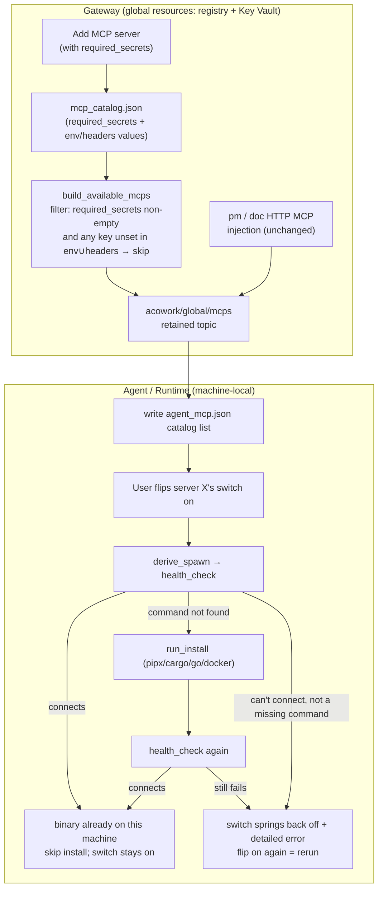

# ADR-090: MCP Install Moves to the Agent's First Enable — Gateway Keeps the Global Registry and Key Vault

**Status**: Accepted (implemented 2026-10-10)
**Date**: 2026-10-09
**Decision makers**: Nicholas (plan confirmed)

> The filename slug `mcp-lsp-install-ownership-node` is a historical artifact: this ADR was originally merged with LSP and proposed moving the entire registry down to the Node. After review it was split — the LSP part became [ADR-091](../zh/ADR-091-lsp-server-registry-node.md), and the MCP part was rewritten under the new model ("Gateway keeps the registry, install moves to the Agent"). The original filename is kept so existing links don't break.

**Related**:
- [ADR-055](../zh/ADR-055-remote-runtime-node-topology.md) (§6.1 responsibility table — this ADR **preserves** its classification of MCP as a Gateway global resource; the original ADR-090's plan to move it to the Node is **void**)
- [ADR-072](../zh/ADR-072-mcp-install-package-spec.md) (declarative `McpPackageSpec` — this ADR **inherits** all of its decisions, changing only the **execution location** of install commands from the Gateway process to the Agent process)
- [ADR-069](../zh/ADR-069-mcp-tool-level-optin.md) (MCP tool-level opt-in — `active_server_names` semantics unchanged)
- [ADR-091](../zh/ADR-091-lsp-server-registry-node.md) (LSP server registry moves to the Node — split from this ADR in the same review; MCP and LSP follow **different** models, see §4.4)

---

## 1. Decision Summary

### 1.1 One sentence

The **imperative, machine-local** act of "installing" moves out of the Gateway process into the **Agent (Runtime) process**, executed when an Agent **first enables** an MCP server; the Gateway **keeps the full MCP registry and API Key Vault**, its responsibilities reduced to "add server + maintain key" — no install operations at all. The push policy changes from "push only installed entries" to "push everything except 'requires a key that isn't configured'". Installed-ness is not persisted as a boolean; it is probed by `health_check` (PATH is the machine's naturally shared state), achieving "install once per machine, later Agents skip it". **The registry does NOT move to the Node** — the original bug (Gateway installs on its own machine; a Runtime scheduled onto a remote Node can't find the binary when spawning) is fixed naturally by "install happens on the Agent's machine", with no Node-side MCP file, API, or reverse proxy.

### 1.2 Key decisions

| # | Decision | Content |
|---|----------|---------|
| D1 | Gateway responsibilities shrink | Gateway keeps the full MCP registry + API Key Vault and does only two things: "add server" and "maintain key"; Gateway-side install execution (`install_server` etc.) is **deleted**. MCP remains a Gateway global resource per ADR-055 §6.1 |
| D2 | Separation of three concerns | Registry (declarative, global, Gateway) / install action (imperative, machine-local, Agent process) / install state (machine fact, PATH is the state, no state file) each return to their proper place instead of being bundled down to the Node |
| D3 | Push filter policy change | `required_secrets` non-empty **and** any required name missing across `env ∪ headers` → **not pushed**; everything else (no-secret servers + fully keyed ones) is pushed to Agents. Replaces the old "push only when `install.state == Installed`" |
| D4 | New backend field `required_secrets` | `McpServerConfigDef.required_secrets: Vec<String>` ([protocol.rs:1674](../../../core/acowork-core/src/protocol.rs#L1674)). Today "which keys are required" is hardcoded only in the frontend [mcp-presets.ts](../../../apps/acowork-desktop/src/lib/mcp-presets.ts); the backend knows nothing. For the Gateway to filter, the catalog must first learn it. **This is the ADR's only new schema.** Named `secrets`, not `env`: key location varies with transport (stdio keys live in `env`, custom HTTP keys in `headers`), so filtering resolves each key name across `env ∪ headers`, reusing the existing `extract_api_key_from_mcp_config` ([resource_cache.rs](../../../core/acowork-gateway/src/resource_cache.rs)) convention of scanning both — no second field |
| D5 | Install moves down + health_check-first + toggle-triggered | **Trigger**: when the user **flips an MCP switch on** in the right panel (server enters `active_server_names`, i.e. ensure-usable). Order: `derive_spawn` → `health_check` (spawn directly) → connects ⇒ binary already on this machine, skip install; spawn fails (command not found) → `run_install` → `health_check` again. This **inverts** the current Gateway "unconditional install first" order |
| D6 | Failure = cannot enable + detailed error + no persisted state | Final failure → **the MCP stays off (switch springs back)**, never silent; returns a **detailed error** (which runtime/dependency is missing, install-command stderr summary) so the user can fix their environment. Flipping the switch on again = rerun the whole flow. No persisted boolean `install_state`; all UI states (probing / usable on this machine / needs install / failed) are driven by `health_check`; "install once per machine" relies on PATH — a machine-local fact naturally shared across Agents — needing no state file or cross-process sync |
| D7 | No machine-level install lock | No homegrown lock (marker-file locks risk permanent wedging when an agent crashes). Relies on pipx venv locks / cargo package-cache locks / docker content-addressing for concurrency safety; health_check-first shrinks the race window to the one-time "first on this machine, genuinely never installed" event. Residual race is **explicitly accepted** |
| D8 | Script kind stays out of the automatic path | There are no `assets/mcp_install/*.sh` today; all presets are npm/uvx/pipx/cargo/go. First-enable only runs `derive_install_command` ([install.rs:257](../../../core/acowork-mcp/src/install.rs#L257)); no arbitrary shell is executed |
| D9 | Keep `mcp_install`/`mcp_uninstall` tools | The Agent's ability to install its own MCPs is **not removed** — it writes the `local` list of `agent_mcp.json`, an independent path from the Gateway-pushed `catalog` list |
| D10 | Install-status UI moves | Install status moves from the Settings menu to the right-panel MCP list, showing health_check-driven states |
| D11 | Runtime needs no `--node-data-dir` | Compared to the original ADR-090, the Runtime no longer needs node_data_dir for MCP (there is no Node-level MCP file to read) |
| D12 | Gateway install endpoints retired | `install_server` (:895), `install_check` (:953), `install_catalog_entry` (:999) deleted from `mcp_catalog_api.rs`; `add/update/list/remove/probe` kept (registry CRUD stays in the Gateway) |
| D13 | Key delivery path unchanged | API keys keep the existing in-memory `mcp_key_vault` / `auth_token` delivery path ([resource_cache.rs](../../../core/acowork-gateway/src/resource_cache.rs) `build_mcp_key_vault`), never persisted to Agent disk; `pm`/`doc` HTTP MCP injection logic unchanged |
| D14 | LSP is out of scope here | LSP follows [ADR-091](../zh/ADR-091-lsp-server-registry-node.md)'s "registry moves to the Node" model; the divergence is explained in §4.4 |

---

## 2. Background & Current Facts

### 2.1 The original bug (the real problem this ADR solves)

stdio MCP servers are `fork/exec`'d by the Runtime, so the binary must live on the **same machine** as the Runtime. The current flow: the user clicks "Install" in the Gateway settings page → the Gateway process ([mcp_catalog_api.rs:895](../../../core/acowork-gateway/src/http/mcp_catalog_api.rs#L895) `install_server` → `run_install_pipeline`:785) runs `pipx install` / `cargo install` on the **Gateway's machine** → the binary lands in the Gateway machine's PATH. When the Runtime is scheduled by a Node onto **another machine**, spawn can't find the binary.

> The original ADR-090's fix was "move the whole registry to the Node". This ADR's fix is "move the install action into the Agent process" — wherever the Agent runs, the binary gets installed there; the bug disappears the same way, with a far smaller blast radius.

### 2.2 Current install semantics probe the runtime, not the package

- `probe_runtime` ([install.rs:71](../../../core/acowork-mcp/src/install.rs#L71)) checks only whether the **runtime** exists (pipx/cargo/uvx installed?), **not the specific package** (it can't tell whether docling itself is installed).
- The current `install_server`, once triggered, runs `run_install` **unconditionally** ([mcp_catalog_api.rs:907](../../../core/acowork-gateway/src/http/mcp_catalog_api.rs#L907)) without first probing whether the binary is already present.
- `health_check` ([install.rs:339](../../../core/acowork-mcp/src/install.rs#L339)) does spawn + initialize + tools/list and returns the tool count. **It is itself the reliable probe of "is the binary there and usable".**

→ These two facts force D5 to invert the order to health_check-first; otherwise "install once per machine" would degrade into "every Agent reruns a minutes-long `cargo install`".

### 2.3 "Which keys are required" today: frontend-hardcoded, invisible to the backend

| Fact | Location |
|------|----------|
| "Which server needs which API key" = hand-written `requiredEnv` arrays in the frontend | [mcp-presets.ts](../../../apps/acowork-desktop/src/lib/mcp-presets.ts) (e.g. `brave-search → ["BRAVE_API_KEY"]`) |
| Frontend type | [types.ts:2260](../../../apps/acowork-desktop/src/lib/types.ts#L2260) `McpPresetDef.requiredEnv` |
| Backend `McpServerConfigDef` | **No** corresponding field ([protocol.rs:1674](../../../core/acowork-core/src/protocol.rs#L1674)) |
| Whole-backend `grep required_env` | **Zero hits** |

The backend catalog stores only `env` (the **real key values** the user typed) and masks display via the `key/token/secret/password` keyword heuristic ([mcp_catalog_api.rs:387](../../../core/acowork-gateway/src/http/mcp_catalog_api.rs#L387)), but **does not know which keys are required**. Hence the D3 filter must live in the Gateway, and for the Gateway to filter it first needs the D4 field.

### 2.4 Push path today (kept, filter changes only)

The `acowork/global/mcps` retained topic is built by [global_resources_builders.rs:258](../../../core/acowork-gateway/src/mqtt/global_resources_builders.rs#L258) `build_available_mcps`: reads the catalog, extracts env/headers → assembles the `McpRef` list → **additionally injects the Gateway-hosted `pm`/`doc` HTTP MCPs** (when `pm_mcp_url`/`doc_mcp_url` exist). The Runtime's `mqtt/client.rs` writes the received list into `agent_mcp.json`'s `catalog` ([agent_config.rs:892](../../../core/acowork-runtime/src/agent_config.rs#L892) `save_agent_mcp_config_catalog`).

> This ADR **keeps the whole path**, adding only the D3 filter in `build_available_mcps`. The `pm`/`doc` injection is untouched — they are HTTP, need no install, and naturally satisfy "no key required ⇒ pushed".

### 2.5 The Runtime has no Node HTTP channel

`grep 19900|node.*http core/acowork-runtime/src/` → **zero hits**: the Runtime connects only to the Gateway (MQTT + localhost HTTP), **never directly to a Node**. This rules out "Agent calls the Node API to install on its behalf" (a new Runtime→Node link would be required) and conversely confirms D5's "Agent process execs pipx itself" as the cheapest wiring — the Runtime already links `acowork-mcp` (Cargo.toml), so `run_install`/`health_check` are direct calls, and the Runtime process inherits the Node machine's PATH/env.

---

## 3. Alternatives

| Option | Description | Rejection rationale |
|--------|-------------|---------------------|
| **A (original ADR-090)** | Move the whole registry to the Node; Gateway becomes a pure reverse proxy; Node holds `mcp_servers.json` + MCP API | Large blast radius (Node file + API + proxy + migration); violates ADR-055 §6.1 "MCP is a Gateway global resource"; introduced 3 blockers (pm/doc would disappear, migration is cross-machine, `--node-data-dir` breaks standalone). **This ADR supersedes A** |
| **B** | Gateway keeps installing, then distributes binaries to every Node | Requires cross-machine binary transfer + per-machine state sync for every package manager; complexity explodes; YAGNI |
| **C (this ADR)** | Registry/keys stay in the Gateway; install moves to the Agent's first enable; PATH is the state | **Adopted** |
| **D** | Install moves to the Node (Agent calls Node API to install on its behalf) | The Runtime has no Node HTTP channel (§2.5); a new link would be needed; and the Node is just a per-machine daemon — letting it own install logic is less direct than the Agent process that actually uses the server installing it itself |

---

## 4. Rationale

### 4.1 Separation of concerns beats wholesale relocation
"Which servers exist + which keys they need" is **declarative, global** knowledge — naturally a Gateway global resource. "Get the binary onto this machine" is an **imperative, machine-local** act — naturally the Agent process's job. The original ADR-090 bundled both to the Node to fix one bug ("install happened on the wrong machine") — but the root cause was only the **install action** running on the wrong machine; the registry in the Gateway was never wrong. Moving only the action fixes the bug just as well, with cleaner boundaries.

### 4.2 PATH is the state: zero new storage for install-once semantics
"Install once on this machine, later Agents skip it" needs no cross-Agent synchronized `install_state` file — whether the binary is in PATH, `health_check` learns it by spawning once. D5's health_check-first treats this naturally shared state directly as the install predicate, eliminating the whole apparatus of ADR-090-A's Node state file, merge rules, atomic writes, and permission management.

### 4.3 Minimal blast radius
Kept: MCP registry, `acowork/global/mcps` push, `pm`/`doc` injection, `mcp_install`/`mcp_uninstall` tools, Key Vault delivery path. Deleted: Gateway install-execution endpoints. Added: 1 schema field + 1 push filter + Runtime first-enable logic + UI status placement. The entire Node-side MCP scope is **not done**.

### 4.4 Why LSP doesn't follow the same model (the split from ADR-091)

| Dimension | MCP | LSP |
|-----------|-----|-----|
| Artifact shape | spawn-and-go package (binary in PATH is enough) | resident sidecar (must listen, must relay — not "just spawn it") |
| State probe | `health_check` spawn probes it | no "PATH is the state" equivalent; needs an explicit registry + process lifecycle |
| Ownership conclusion | install moves to the Agent, registry stays in the Gateway | registry moves to the Node (ADR-091) |

An LSP server is a Node-hosted resident sidecar whose "installed? running?" is a Node process fact requiring a Node-level authority; an MCP server is an on-demand child process of the Agent whose "installed?" is a PATH fact needing no authority file. Hence the split.

---

## 5. Detailed Design

### 5.1 End-to-end flow (new model)



### 5.2 Schema change (D4)

```rust
// core/acowork-core/src/protocol.rs — McpServerConfigDef
pub struct McpServerConfigDef {
    // ... existing fields unchanged ...
    /// Secret names this server REQUIRES to be usable (e.g. API keys).
    /// Populated from the frontend preset at "add server" time and persisted
    /// in the Gateway catalog. Gateway's `build_available_mcps` skips pushing
    /// an entry whose required_secrets is non-empty while any required name is
    /// missing/empty across BOTH `env` and `headers` (stdio keys live in env,
    /// custom HTTP keys live in headers — same lookup convention as
    /// `extract_api_key_from_mcp_config`). Empty vec => usable without secret.
    #[serde(default)]
    pub required_secrets: Vec<String>,
}
```

- At "add server" the frontend POSTs `preset.requiredEnv` into the catalog as well ([mcp_catalog_api.rs:453](../../../core/acowork-gateway/src/http/mcp_catalog_api.rs#L453) `add_catalog_entry` receives it). The preset's `requiredEnv` means exactly "required secret names": env names for stdio, header names for custom HTTP.
- `#[serde(default)]` keeps old catalog files without the field working as "no key required" — backward compatible.

### 5.3 Push filter (D3)

In `build_available_mcps` ([global_resources_builders.rs:258](../../../core/acowork-gateway/src/mqtt/global_resources_builders.rs#L258)) where the `McpRef` list is built, add a per-entry check. Key values are looked up in `env ∪ headers` (consistent with `extract_api_key_from_mcp_config`):

```
fn secret_configured(entry, name) -> bool {
    entry.env.get(name).or(entry.headers.get(name))
        .map(|v| !v.trim().is_empty()).unwrap_or(false)
}

if !entry.required_secrets.is_empty()
   && entry.required_secrets.iter().any(|k| !secret_configured(entry, k)) {
    skip  // requires keys that aren't fully configured → don't push to Agents
}
```

The `pm`/`doc` injection branch is unaffected (their `required_secrets` are empty or they go through separate injection).

### 5.4 First-enable install logic (D5, Runtime side)

The Runtime gains an "ensure server usable" routine (reuses `acowork-mcp`, no new dependency):

```
fn ensure_usable(name, pkg, spawn, env):
    // 1. probe first (PATH is the state)
    match health_check(spawn).await:
        Ok(_) => return Usable          // already on this machine, skip install
        Err(command_not_found) => {}     // proceed to install
        Err(other) => return Failed(other)   // can't connect, not a missing command → fail with reason
    // 2. install (derive_install_command only, no shell)
    match run_install(pkg).await:        // install.rs:301
        Ok(_) => {}
        Err(e) => return Failed(e)        // install failed: pass through stderr summary
    // 3. re-probe
    match health_check(spawn).await:
        Ok(_) => return Usable
        Err(e) => return Failed(e)
```

- **Trigger**: when the user **flips an MCP switch on** in the right panel (server enters `active_server_names`, ADR-069 opt-in), ensure is triggered synchronously. The switch state = the ensure result: only `Usable` keeps it on; `Failed` **springs the switch back off** and shows the error.
- **Failure means unusable**: no silent degradation. `Failed` must carry a **detailed error** — which runtime is missing (pipx/cargo/docker not installed), the install command's stderr summary, the health_check handshake failure reason — so the user can fix environment dependencies themselves.
- **Retry = flip the switch again**: failed state is not cached; flipping on again reruns the whole flow (likely failing again, hence error quality is key).
- npm/uvx kinds return `None` from `derive_install_command` (`npx -y`/`uvx` resolve lazily) → step 2 is skipped, relying on step 1's health_check (first spawn triggers the npx download).
- Concurrency (D7): no locks; rely on package managers' own locks + the one-time window.

### 5.5 UI (D10)

- Remove the install-status section from the Settings menu.
- The settings page is a **single list with two row kinds**: preset rows are permanent (not added → "Add"; added → "Added", with **no Remove** — the registry copy of a built-in template is not the user's to delete); custom rows (catalog entries matching no preset) carry Remove. Neither row kind has a **Test** button (see §5.6 — runtime probing is not the Gateway's job).
- Each item in the right-panel MCP list shows a health_check-driven state: `probing / usable on this machine / needs install / failed (detailed reason)`. Wording uses "**usable on this machine**", not "installed for this Agent" — the binary is a machine-wide shared fact; avoid misleading users.
- The failed state shows the detailed error (missing runtime / dependency / install stderr summary) and offers "retry" (= flip the switch back on).
- "Which keys are required" display may still use the frontend preset (`requiredEnv`), but the **filter's source of truth is the catalog** (D4 `required_secrets`); the two must stay aligned.

### 5.6 Deletions (D12)

| Delete | Location |
|--------|----------|
| `install_server` | [mcp_catalog_api.rs:895](../../../core/acowork-gateway/src/http/mcp_catalog_api.rs#L895) |
| `install_check` | [mcp_catalog_api.rs:953](../../../core/acowork-gateway/src/http/mcp_catalog_api.rs#L953) |
| `install_catalog_entry` | [mcp_catalog_api.rs:999](../../../core/acowork-gateway/src/http/mcp_catalog_api.rs#L999) |
| `run_install_pipeline` | [mcp_catalog_api.rs:785](../../../core/acowork-gateway/src/http/mcp_catalog_api.rs#L785) |
| `/api/mcp-catalog/install*` routes | [mcp_catalog_api.rs:43-46](../../../core/acowork-gateway/src/http/mcp_catalog_api.rs#L43) |

`probe_server_config`/`probe_catalog_entry` and the `/api/mcp-catalog/probe*` routes are **deleted as well**. The original "keep them as a Gateway-side pre-add check" contradicted D1: a Gateway-process probe of a stdio server spawns on the **Gateway's machine** — the same bug class as "the binary must live on the Agent's machine" — and with multiple Nodes there is no answer to "which Node's server is being tested". Server usability is verified by the Agent at first enable (§5.4); the settings page performs no runtime probing.

---

## 6. Impact on Existing ADRs

| ADR | Impact |
|-----|--------|
| ADR-055 §6.1 | **Preserves** "MCP is a Gateway global resource" — the original ADR-090's planned amendment is void; ADR-055 needs no change |
| ADR-072 | **Inherits** all decisions; only the install command's execution location moves from the Gateway process to the Agent process (§2.1/§4.1); the declarative spec is unchanged |
| ADR-069 | `active_server_names` semantics unchanged; first enable = "enters active AND ensure usable" |
| ADR-091 | LSP independently follows "registry moves to the Node"; the divergence from this ADR is in §4.4 |

---

## 7. Consequences

### 7.1 Positive
- The original remote-Node spawn bug disappears (install happens on the Agent's machine).
- Blast radius far smaller than the original ADR-090: no Node MCP file/API/proxy, no migration, no `--node-data-dir`.
- Gateway boundary returns to the ADR-055 global-resource classification; pm/doc injection unaffected.
- "Install once per machine" rides on PATH's natural sharing — zero new storage.
- The Agent's autonomous install capability (`mcp_install`) is preserved.

### 7.2 Negative & costs
- One new schema field `required_secrets` (the only substantive data-model change).
- The Runtime process gains the ability to run package managers (pipx/cargo/docker) — a wider permission surface (though the `mcp_install` tool already had it; no new attack surface).
- Install state is a per-agent view; two Agents on the same machine could briefly disagree on health_check results (one just probed, one hasn't), but both point at the same PATH truth and converge.

### 7.3 Risks (with mitigations)

| Risk | Mitigation |
|------|------------|
| Same machine, concurrent first-enable of the same package → double install | Rely on pipx/cargo/docker's own locks; the window is the one-time "first on this machine, genuinely never installed" event; explicitly accepted (D7) |
| `cargo install` recompiles for minutes | health_check-first avoids it: if the binary exists, connect directly, never rerun |
| Frontend `requiredEnv` drifts from catalog `required_secrets` | D4 makes the catalog the filter's truth; written at add time, UI display aligned to the catalog |
| Old catalogs lack `required_secrets` | `#[serde(default)]` → treated as "no key required", backward compatible |

---

## 8. Migration & Rollback

- **Migration**: none. Old catalogs missing `required_secrets` fall back to the default (no key required), behaviorally equivalent to "push everything as before", breaking no existing Agent. The frontend fills `required_secrets` naturally on the next "add/edit server".
- **Rollback**: the D4 field carries `#[serde(default)]`; rolling back code leaves the extra field ignored with no schema breakage. Deleting the Gateway install endpoints is the only irreversible move — to roll back, restore `install_server`; the registry and push path were never touched, so rollback cost is low.

---

## 9. Implementation Scope

| Phase | Content | Files |
|-------|---------|-------|
| P0 | `McpServerConfigDef` gains `required_secrets`; frontend add/edit writes it | `protocol.rs`, `mcp_catalog_api.rs::add_catalog_entry`, frontend add-server flow |
| P1 | `build_available_mcps` gains the D3 filter | `global_resources_builders.rs:258` |
| P2 | Runtime toggle-triggered ensure-usable (health_check-first → run_install → re-probe; failure springs back + detailed error) | `acowork-runtime` (new routine, reusing `acowork-mcp::install`) |
| P3 | Delete Gateway install endpoints + routes | `mcp_catalog_api.rs` |
| P4 | UI install status moves from Settings menu to right panel | frontend HarnessPage / tools panel |
| P5 | Regression: remote-Node spawn, concurrent first-enable, old-catalog compatibility | `dev/ci.sh` + integration tests |

**Not done**: Node-level `mcp_servers.json`, Node MCP API, Gateway→Node MCP reverse proxy, `--node-data-dir`, per-agent `install_state` persistence, machine-level install lock, script-kind automatic paths.

---

## 10. Settled Decisions (formerly open questions, resolved in review)

1. **Trigger = flipping the switch on**: when the user flips an MCP switch on in the right panel (server enters `active_server_names`), ensure is triggered synchronously and status is shown immediately. Slow operations like `cargo install` run async with UI "probing/installing" states, never blocking interaction. See D5/§5.4.
2. **Failure = cannot enable + detailed error + retry by re-flipping**: final ensure failure → switch springs back off, never silent; a detailed error (missing runtime/dependency, install stderr summary, handshake failure reason) is returned for the user to resolve environment dependencies; flipping on again = rerun the whole flow. See D6/§5.4.
3. **Filter covers `env ∪ headers`**: the field is named `required_secrets` (not `required_env`); each key name resolves across `env ∪ headers`, reusing the existing `extract_api_key_from_mcp_config` convention of scanning both — stdio keys in env, custom HTTP keys in headers, covered in one pass without a second field. `pm`/`doc` are self-hosted without keys and unaffected. See D3/D4/§5.3.
4. **UI wording = "usable on this machine"**: the binary is a machine-wide shared fact; status reads "usable on this machine", not "installed for this Agent", to avoid misleading. See D6/§5.5.
