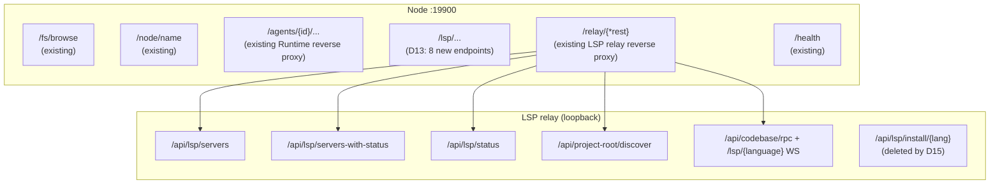

# ADR-091: LSP Server Registry Moves Down to the Node — preset ∪ custom Merge, Persistent Install State

**Status**: Accepted (implemented 2026-10-10, P0–P7; post-implementation files and line numbers are written back, see the "Implementation status" note at the end of §9)
**Date**: 2026-10-09 (revised against the code and implemented 2026-10-10)
**Decision makers**: review complete, implemented

**Related**:
- [ADR-019](../zh/ADR-019-lsp-relay-standalone-process.md) (LSP relay decoupled into a standalone process)
- [ADR-030](../zh/ADR-030-sidecar-endpoint-dynamic-push.md) (sidecar endpoint dynamic push)
- [ADR-055](../zh/ADR-055-remote-runtime-node-topology.md) (§6.7 Sidecar Scope model)
- [ADR-087](../zh/ADR-087-node-agent-owner-permissions.md) (Node ownership gating; custom/install go through the manage permission)
- [ADR-089](../zh/ADR-089-lsp-relay-reachability-vs-exposure.md) (D2 Gateway → Node → LSP relay reverse proxy)
- [ADR-090](../zh/ADR-090-mcp-lsp-install-ownership-node.md) (split in the same review; this ADR is the independent evolution of its LSP half)

---

## 1. Decision Summary

### 1.1 One sentence

LSP server install and spawn happen on the same machine — the Node — because artifacts of `rustup component add rust-analyzer` / `pip install python-lsp-server` land on the Node's filesystem; therefore **the authoritative source of the server registry is the Node**, not the Gateway. The Gateway degrades to a pure reverse proxy.

`assets/lsp_servers.json` becomes a **read-only preset** (shipped with the suite, MUST NOT be written at runtime); a new `{node_home}/lsp_servers.json` becomes the **single runtime source of truth** (preset ∪ custom ∪ install state), merged by the Node at startup and read/written at runtime.

### 1.2 Boundary with ADR-090 (MCP)

| Dimension | ADR-090 MCP | ADR-091 LSP (this ADR) |
|------|------------|---------------------|
| Existing registry location | Gateway holds `mcp_catalog.json` | Node already publishes upstream on the `acowork/nodes/{id}/lsps` topic, Gateway only consumes |
| Source of truth to be moved | Gateway-side catalog + list + key_vault | None; today only the preset is read |
| `acowork/global/<thing>` topic push | Live path (including pm/doc-hosted MCP) | Deprecated ([node_registry.rs:35-46](../../../core/acowork-gateway/src/mqtt/node_registry.rs#L35)) |
| Install duration | MCP `pipx install`, minutes | LSP `pip install`, seconds (idle timeout 60 s) |
| Install executor | Agent (Runtime process, at first enable) | **The Node process** (the relay is a sidecar, not spawn-on-demand) |
| Cross-process truth | No cross-process sync — the registry stays in the Gateway, install moves down to the Agent, PATH is the state ([ADR-090 §Decision C](./ADR-090-mcp-lsp-install-ownership-node.md)) | **Two processes: Node ↔ LSP relay** (Node owns the file, the relay only reads it and owns probing) |
| Is the Runtime informed | Runtime reads mcp_servers.json directly | The Runtime takes no part in LSP — **LSP and the Runtime are physically isolated** |
| Migration cost | One-time split of catalog → multiple Nodes | **No migration** — custom servers were never supported |

> Conclusion: LSP is one notch simpler than MCP — no Gateway↔Node truth synchronization, no Gateway-hosted LSP, no Runtime involvement, no legacy data to migrate. **Every risk of this ADR lives inside the Node process and in the state convergence between that one pair of same-machine processes, Node ↔ LSP relay** (who probes, who writes back, how a configuration change propagates; see §5.6/§5.8).

### 1.3 Key decisions

| # | Decision | Content |
|---|------|------|
| D1 | Preset is read-only, ships with the suite | `assets/lsp_servers.json` + `assets/lsp_install/` (unchanged), MUST NOT be written at runtime |
| D2 | The runtime file is the single source of truth | `{node_home}/lsp_servers.json` = the three-way merge of preset ∪ custom ∪ install state |
| D3 | Distinguish by path domain, not by suffix | The runtime file and the preset share the name `lsp_servers.json`; the directory tells them apart (`assets/` vs `{node_home}/`) |
| D4 | Flat layout in the Node | Follows the existing `{node_home}` convention (`identity.json` / `state.json` / `packages/` / `logs/` / `runtime-logs/` are all flat); `lsp_servers.json` joins them at the same level |
| D5 | `source` field is persisted | Every entry carries `source: "preset" \| "custom"`, used for UI grouping and merge arbitration |
| D6 | Merge rule: refresh metadata, keep instances and state | A preset upgrade refreshes `candidates/args/description/install_hint/install_script/root_markers`; the user's `candidate_args` and `install_state` are preserved |
| D7 | No reset-to-preset | No "restore preset defaults" entry point; if the user edits something wrongly, they edit it back |
| D8 | File permission 0600 + atomic write | The runtime file MUST be written `tmp + fsync + rename`; POSIX 0600, on Windows via ACL or a degraded no-op + warn |
| D9 | Install state is persisted, **converged by the Node** | After an install completes, the `install_state` section is written; relay probe results are **pulled by the Node from loopback `/api/lsp/status` and written back** (the relay MUST NOT write the runtime file — see the P6 red line) |
| D10 | `installing` is not persisted | No `installing` residue after a process crash; in-flight state lives in memory only, and losing it just means the next attempt retries |
| D11 | Single writer in the Node | The Node's in-memory state is the only read/write entry (`Arc<RwLock<LspRegistry>>`); every handler mutates inside the write lock and calls `save()` once; install serialization is protected by `LspInstallGuard` |
| D12 | LSP relay restart model | A configuration change triggers a relay process restart (taken over by the supervisor, **with debouncing**); the relay itself has no hot reload (`OnceLock`, single load). Cost: a restart drops the LSP WebSocket an editor is using (§7.2-2) |
| D13 | Node-side API contract | The Node HTTP server exposes **8** endpoints under `/lsp/...` (no `/api` prefix, consistent with the existing `/fs/browse` / `/node/name` convention); the Gateway reverse-proxies them at `/api/nodes/{id}/lsp-admin/{*tail}` (it does not reuse the existing `/api/nodes/{id}/lsp/{*tail}` passthrough path) |
| D14 | ADR-087 gating lives in the **Gateway** | custom creation / `PUT` / `DELETE` / `install` are decided inline by the Gateway's `lsp_admin_proxy` handler via `ownership::can_manage` before forwarding; the Node only validates the node token (§5.7) |
| D15 | The relay's install endpoint retires | `POST/GET /api/lsp/install/{language}` is deleted from the LSP relay — the Node is the only install executor, otherwise anything installed through the relay would never write `install_state` (§5.10) |
| D16 | Preset asset directory and runtime directory are separate | `ACOWORK_LSP_CONFIG_DIR` (where the runtime file lives, = `{node_home}`) and `ACOWORK_LSP_ASSET_DIR` (the `lsp_servers.json` preset + `lsp_install/` scripts, = Desktop resource dir) are split into two env vars so that repointing the config dir at `{node_home}` cannot degrade install-script resolution (§5.11) |

---

## 2. Background and Facts on the Ground

### 2.1 The LSP physical chain (frame of reference)

| Stage | Location |
|------|------|
| Preset metadata | `assets/lsp_servers.json` (version 1, 12 built-ins: `rust` / `python` / `typescript` / `go` / `c` / `json` / `yaml` / `html` / `css` / `markdown` / `java` / `kotlin`) |
| Install scripts | `assets/lsp_install/{rust,python,typescript,go,clangd,json,yaml,markdown,kotlin,java,css,html}.{sh,ps1}` (12 sets) |
| dev copy | `apps/acowork-desktop/src-tauri/build.rs:142-156` → `target/{profile}/bin/` |
| release bundling | `apps/acowork-desktop/src-tauri/tauri.conf.json:58` `bundle.resources` mapping |
| Location injection | `apps/acowork-desktop/src-tauri/src/commands/gateway.rs:545` `env("ACOWORK_LSP_CONFIG_DIR", resource_dir)` |
| Load candidates | [`core/acowork-lsp-relay/src/config.rs::build_config_candidates()`](../../../core/acowork-lsp-relay/src/config.rs): `$ACOWORK_LSP_CONFIG_DIR` → `$CARGO_MANIFEST_DIR/../../assets` → `exe_dir` → `cwd` |
| Fallback | `builtin_lsp_defaults()` ([config.rs:239](../../../core/acowork-lsp-relay/src/config.rs#L239)) |
| Install execution | LSP relay `POST /api/lsp/install/{language}` (formerly relay `install.rs:77`; P6 of this ADR deleted the file along with the route), called directly by the Desktop `lspInstallStore` — this ADR moves it to the Node (D15, implemented in [lsp_install.rs:103](../../../core/acowork-node/src/lsp_install.rs#L103)) |
| Endpoint forwarding | Gateway `lsp_proxy.rs:49` `/api/nodes/{id}/lsp/{*tail}` → Node `/relay/{*tail}` ([proxy/mod.rs:66](../../../core/acowork-node/src/proxy/mod.rs#L66)) → LSP relay loopback |

### 2.2 The two capabilities LSP lacks today (what this revision targets)

1. **No way to add a server** — the `LspServerEntry` schema is already complete ([config.rs:24-44](../../../core/acowork-lsp-relay/src/config.rs#L24)), but the only entry point is overriding a key in `assets/lsp_servers.json`; **there is no user-side ability to add a key**. The "preset ∪ custom merge" problem was never exposed.
2. **Install state is not persisted** — there is only the in-process probe cache `STATUS_CACHE: OnceLock<RwLock<HashMap<String, (LspServerStatusEntry, Instant)>>>` ([config.rs:1104](../../../core/acowork-lsp-relay/src/config.rs#L1104), default TTL 1800 s), so every restart re-probes 12 LSP binaries. Once custom servers exist this flaw is amplified (install scripts can take minutes).

### 2.3 What LSP install and spawn actually mean

- **install** = installing the language server binary (`rustup component add` / `pip install python-lsp-server` / `npm install -g typescript-language-server`, etc.); artifacts land on the Node's filesystem
- **spawn** = the LSP relay pulls it up on demand with `tokio::process::Command::new(candidate)` ([config.rs:1226](../../../core/acowork-lsp-relay/src/config.rs#L1226) `probe_one`); this runs inside the relay process (the relay is a child of the Node, so downstream stays on the same machine)
- **Probing is not a millisecond cost**: `probe_one` is a fork+exec of `cmd --version`, ~2 s timeout per call, concurrency bounded by `LSP_STATUS_PROBE_CONCURRENCY`; the relay's own comment says "roughly 6 s for 13 languages" ([config.rs:1057-1061](../../../core/acowork-lsp-relay/src/config.rs#L1057), [config.rs:1126-1132](../../../core/acowork-lsp-relay/src/config.rs#L1126)) — the TTL cache exists precisely for that. Startup validation in this ADR MUST be asynchronous (§5.8)
- **There is no `install_state` enum today**: the relay only has `LspServerStatusEntry{language, installed: bool, command}`; `unknown/detected/installing/installed/failed` and `InstallStage` are types **newly minted** by this ADR (§5.2), not inherited
- Unlike MCP's `kind=="script"`: LSP installs always run **a script shipped inside the suite** (`assets/lsp_install/*.sh`); **there is no notion of "the user pastes a shell string"** (see open question Q1)

### 2.4 `acowork/nodes/{node_id}/lsps` is already in place

`core/acowork-gateway/src/mqtt/node_registry.rs:35-46` comments: the LSP server list travels on a **per-node retained topic**, and the deprecated `acowork/global/lsps` is gone. The `AvailableLsps` envelope is published by the Node (including `lsp_endpoint` for the health probe); the Gateway only consumes it, never produces it. **This ADR needs no new Gateway→Node push channel** — it is a one-way "Node → Gateway" fact broadcast.

### 2.5 The `LspTab` UI already filters by Node

[`apps/acowork-desktop/src/components/harness/LspTab.tsx`](../../../apps/acowork-desktop/src/components/harness/LspTab.tsx#L106) already has a Node picker (`relayNodes` state, `effectiveNodeId` resolution, `fetchNodes()` for the candidates); it reads `{relay}/api/lsp/servers` through the ADR-089 D2 reverse proxy (LspTab.tsx:202) plus `{relay}/api/lsp/status` (LspTab.tsx:238) — `servers-with-status` exists in `gateway-api.ts:641` but the UI **does not use** it (the comment in that file says outright it is not the preferred load path). Installation goes through `{relay}/api/lsp/install/{lang}` (`lspInstallStore`). This ADR moves install, creation, and state reads onto the Node API.

**This ADR only extends what LspTab can do (custom servers, an install-state column); it does not refactor the Node picker.**

### 2.6 `{node_home}` as it stands

[cli.rs:60-63](../../../core/acowork-node/src/cli.rs#L60): `--home` (visible alias `--work-dir`, env `ACOWORK_NODE_HOME`), default `$HOME/.acowork/acowork-node`; the field name in code is `NodeConfig::home`. Observed contents:

```
identity.json  state.json  packages/  logs/  runtime-logs/
```

There is no `data/` subdirectory. **D4 therefore chooses the flat layout.**

---

## 3. Alternatives

| Option | Description | Why rejected |
|------|------|---------|
| A. Gateway holds the LSP registry and dispatches install | Copying the old MCP design | LSP install artifacts live on the Node; a Gateway-side registry guarantees two sources; and since the Node already has the `acowork/nodes/{node_id}/lsps` upstream path, adding a Gateway→Node push on top is an A-class anti-pattern |
| B. `custom` lives in per-agent directories | At `{work_dir}/lsp_servers.json` | LSP is a Node-global resource (bound to a language, not to an agent); per-agent directories would repeat installs across agents; and in a multi-user setup `{work_dir}` is isolated by ADR-087, so it is not the Node's global view |
| **C. This ADR** | Read-only preset + Node runtime file as the single truth + Gateway as a pure reverse proxy | — |

---

## 4. Rationale

1. **Install and spawn on the same machine is a hard constraint.** The LSP relay is a loopback child process pulled up by the Node, and it in turn `Command::new`s the language server — the binary must live on the same machine, on the same filesystem.
2. **One source beats two.** `acowork/nodes/{node_id}/lsps` is already Node-authoritative upstream; once the runtime file agrees with it, the Gateway only consumes it via the `lsp_endpoint` health probe.
3. **The LSP chain is already proven.** `build.rs` copy, tauri resource mapping, `ACOWORK_LSP_CONFIG_DIR` injection, supervisor spawn, Gateway reverse proxy — all five segments have working implementations; this change reuses rather than invents.
4. **The value of persisting install state.** Today every restart runs a full `probe_all` (`--version` fork+exec over 12 binaries, **seconds**, masked by the TTL cache), so the value there is small; but the **custom server install path** (an install script the user references themselves) becomes markedly slower with no idempotence protection, where persistence pays.
5. **LSP and MCP are kept apart.** The user asked for the two to evolve independently — MCP involves a three-way Runtime / Gateway / Node coordination while LSP stays inside the Node, and **writing them up together would make the two ADRs interfere with each other's readers**.

---

## 5. Detailed Design

### 5.1 File layout

```
install directory (read-only, shipped with the suite)
  assets/lsp_servers.json          # unchanged (D1)
  assets/lsp_install/*.sh|*.ps1    # unchanged

{node_home}/                       # $HOME/.acowork/acowork-node
  identity.json                    # existing
  state.json                       # existing
  lsp_servers.json                 # new — the single runtime source of truth (D2/D3)
  packages/  logs/  runtime-logs/  # existing
```

The two directories have separate jobs (D16):

| env | meaning | value | injected by |
|-----|------|------|--------|
| `ACOWORK_LSP_CONFIG_DIR` | directory holding the **runtime** file (= `{node_home}`) | set by the Node itself at startup | Node supervisor |
| `ACOWORK_LSP_ASSET_DIR` | preset asset directory (`lsp_servers.json` + `lsp_install/`) | Desktop resource dir | the Desktop's existing injection chain (passed through after renaming the variable at gateway.rs:545) |

> The original draft pointed `ACOWORK_LSP_CONFIG_DIR` straight at `{node_home}` — which would leave candidate 0 for install scripts (`{config_dir}/lsp_install/`) empty, with only `exe_dir` / an ancestor `assets/` as a lucky fallback. After splitting the env in two, the preset and the scripts still come from one known directory (Node-side candidate chain: [lsp_install.rs:103](../../../core/acowork-node/src/lsp_install.rs#L103)) and the runtime file is located at exactly one path, `{node_home}/lsp_servers.json` (no candidate chain involved).

### 5.2 Schema

**Preset (read-only, `assets/lsp_servers.json`)** — unchanged: `version: 1, servers: IndexMap<String, LspServerEntry>`.

**Runtime (read/write, `{node_home}/lsp_servers.json`)** — three sections per entry:

```json
{
  "version": 1,
  "servers": {
    "rust": {
      "source": "preset",

      "candidates": ["rust-analyzer"],
      "args": [],
      "candidate_args": {},
      "install_hint": "rustup component add rust-analyzer",
      "install_script": "rust",
      "description": "Rust language server (defaults to stdio, no --stdio flag)",
      "root_markers": ["Cargo.toml"],

      "install_state": "installed",
      "installed_command": "rust-analyzer",
      "install_stdout": "...(truncated at 4 KB)",
      "install_stderr": "...(truncated at 4 KB)",
      "last_install_ms": 1762000000000
    },
    "my-team-lsp": { "source": "custom", "candidates": ["my-lsp"], "...": "..." }
  }
}
```

- `servers` MUST be an `IndexMap` (LSP already stepped on the `HashMap` SipHash random-seed trap; the comment is at [lsp.rs:180](../../../core/acowork-core/src/lsp.rs#L180), and after P0 the type lives in core)
- **Metadata section** (`candidates` / `args` / `candidate_args` / `install_hint` / `install_script` / `description` / `root_markers`) comes from the preset and is refreshed when the preset upgrades (D6). On the Node side this section is wrapped with `#[serde(flatten)] meta: LspServerEntry`, so the JSON shape matches the preset the relay reads
- **Instance section** (for a custom server the user fills the whole section; for a preset server the user may override `candidate_args`)
- **State section** (`install_state` / `installed_command` / `install_stdout` / `install_stderr` / `last_install_ms`) is written by the install / convergence flow (§5.8)
- When deserializing, the relay MUST NOT know about the state section: `LspServerEntry` has no `deny_unknown_fields`, so extra keys are ignored — that is both the compatibility premise and the technical basis of the P6 red line (the relay only ever sees the metadata section)

`install_state` values (an enum **defined by this ADR**, coexisting with the relay's `LspServerStatusEntry{installed,command}`):

| value | meaning | persistable |
|---|------|---------|
| `unknown` | never probed / last result expired | yes |
| `detected` | a binary was found on PATH (not installed by us) | yes |
| `installed` | installed by this flow's install script | yes |
| `failed` | last install exited non-zero / timed out | yes |
| `installing` | in-flight, memory only | **no** (D10) |

### 5.3 Merge rules

```
load_lsp_servers(node_home, preset_registry):
  runtime = read({node_home}/lsp_servers.json) or empty
  merged  = IndexMap::new()
  conflicts = []

  for (name, preset) in preset_registry.servers:           # in preset order
    match runtime.get(name):
      Some(e) if e.source == "custom":
        # name collision (a preset upgrade added a name the user already defined):
        # keep the custom entry, neither silently overwrite it nor write back to the runtime file
        merged[name] = e
        conflicts.push(name)                                 # surfaced in the UI header
      Some(e) /* source == preset */:
        merged[name] = LspRuntimeEntry {
          meta: preset.meta,                                 # metadata section ← refreshed from preset
          candidate_args: e.candidate_args,                  # ← preserved from runtime
          state: e.state,                                    # install_state ← preserved from runtime
          source: "preset",
        }
      None:
        merged[name] = LspRuntimeEntry {
          source: "preset", meta: preset.meta, state: unknown,
        }

  for (name, entry) in runtime.servers:
    if entry.source == "custom" and name not in merged:
      merged[name] = entry                                  # custom entries kept verbatim (appended after the presets)

  return (merged, conflicts)
```

Collision policy: when a preset name collides with a custom name, **the already-existing (custom) entry wins**; the conflict list is reported to the UI with the response and the user renames or deletes it. The "add custom" entry point simultaneously validates that the name is unique across the whole registry (presets included).

Ordering invariant: the merged map always lists presets first (in preset-file order) and customs second (in runtime-file order); both are `IndexMap`s, so the UI list is stable across restarts.

### 5.4 Writing and permissions (D8 + D11)

```
save_lsp_servers(node_home, servers):
  final = {node_home}/lsp_servers.json
  tmp   = final.with_extension("json.tmp")
  write(tmp, serde_json::to_string_pretty(servers))
  f.sync_all()
  set_permissions(tmp, 0o600)          # POSIX; on Windows via ACL or a degraded no-op + warn
  rename(tmp, final)                   # atomic on POSIX
```

`install_stdout` / `install_stderr` contain the npm/pip output of the install and **may carry tokens** (npm private registry / pip index URLs with embedded auth), so 0600 applies just as much.

**Single writer in the Node (D11)**: `Arc<RwLock<LspRegistry>>` is the only truth in Node memory; every Node HTTP handler MUST mutate the map and call `save()` once inside the write lock (the same `tokio::sync::RwLock` convention as the `identity` / `node` tables). `LspInstallGuard` is demoted to a UX guard against concurrent installs of the same name and is **no longer a correctness dependency for concurrency** — `PUT /lsp/servers/{name}` (editing `candidate_args`) racing `POST .../install` (writing the state section) would lose an update.

Note: the write lock MUST NOT be held across an `.await` (the install subprocess and the relay HTTP convergence both run outside the lock; only the result re-enters it) — the Node's `/health` is exactly the probe that detects this class of stall ([proxy/mod.rs:70-102](../../../core/acowork-node/src/proxy/mod.rs#L70)).

### 5.5 Node-side API and the Gateway reverse proxy (D13)

**Node side (`:19900`, node-token authenticated, no `/api` prefix)**:

```
GET    /lsp/servers                       # merged registry (preset ∪ custom + persisted install_state)
GET    /lsp/presets                       # read-only preset registry (candidate source for the UI's add form)
GET    /lsp/servers/{name}/script         # install script text (what D14's "show the script before executing" relies on)
POST   /lsp/servers                       # add a custom server (409 on name collision)
PUT    /lsp/servers/{name}                # edit the instance section (candidate_args / install_script / ...)
DELETE /lsp/servers/{name}                # remove the record (does not delete the language server's artifacts)
POST   /lsp/servers/{name}/install        # run the install_script, write the state back (D15: the only install entry)
GET    /lsp/servers/{name}/install/status # in-flight stage (memory only, new enum)
```

**8** endpoints in total. The draft's `GET /lsp/servers-with-status` was dropped: the relay's combined shape was never used by the UI (§2.5), and implementing another copy on the Node would duplicate the probe logic; live probing keeps going through the relay's `/api/lsp/status` (passthrough path) while persisted state comes from `GET /lsp/servers`.

**LSP relay endpoints**: `/api/lsp/servers`, `/api/lsp/status`, `/api/lsp/servers-with-status` remain, exposed by the relay on loopback and passed through by the Node's `/relay/{tail}` reverse proxy; `/api/lsp/install/{language}` is deleted (D15). The 8 Node APIs of this ADR and the relay's read endpoints coexist in the Node's route tree:



**Gateway side**: the existing `/api/nodes/{id}/lsp/{*tail}` → Node `/relay/{*tail}` (the ADR-089 D2 path, **relay endpoint passthrough, unchanged**). **New**: a reverse-proxy route `/api/nodes/{id}/lsp-admin/{*tail}` → `http://{node.http_endpoint}/lsp/{tail}`, injecting `X-ACowork-Node-Token`, structurally copied from `lsp_proxy.rs`. Two differences from the existing implementation:

1. **Different gating level**: the admin route checks `can_manage` before forwarding (§5.7), whereas the passthrough route only checks `can_view`;
2. **MUST NOT reuse `resolve_relay_target`'s `lsp_endpoint.is_some()` precondition** ([lsp_proxy.rs:221](../../../core/acowork-gateway/src/http/lsp_proxy.rs#L221)): the moment the relay is not ready is exactly when the user wants to fix the configuration or install a server. The admin route only requires the node to be `online` with an `http_endpoint`.

> **Aligning the path prefix with the existing convention**: the Node's current routes have **no `/api` prefix** (`/fs/browse` / `/node/name` / `/agents/{id}/...`), so the Node-side API uses `/lsp/...`. The Gateway side uses `/api/nodes/{id}/lsp-admin/...` (same shape as ADR-089 D2's `/api/nodes/{id}/lsp/...` but a different prefix), and the UI plus `lspStore` distinguish read from write on that basis.

### 5.6 Propagating Node-side state changes to the LSP relay (D12)

```
Node startup:
  1. read preset (ACOWORK_LSP_ASSET_DIR) + read runtime ({node_home}/lsp_servers.json)
  2. merge → in-memory state; save() to disk (the first boot creates the runtime file)
  3. spawn LSP relay (supervisor takes over):
       ACOWORK_LSP_CONFIG_DIR={node_home}      # runtime file
       ACOWORK_LSP_ASSET_DIR=<resource dir>    # preset + lsp_install scripts
     (the env vars are injected explicitly with .env on the Command by `relay_env()`,
      not inherited from the parent —
      [lsp_relay.rs:125-145](../../../core/acowork-node/src/sidecar/lsp_relay.rs#L125))

Configuration change (custom add/remove / instance edit / preset upgrade):
  1. the handler mutates + save() inside the write lock (outside the lock for the I/O)
  2. send a RestartRequest to the supervisor (mpsc); the supervisor kills + respawns the relay
  3. the relay re-inits + reads the runtime file
  4. state convergence: §5.8 (the Node pulls loopback `/api/lsp/status` and writes install_state back)
```

The LSP relay has no hot reload of its own (`OnceLock`, loaded once — see [config.rs:113](../../../core/acowork-lsp-relay/src/config.rs#L113)), so the cost of propagating a configuration change is **one relay restart**. No new reload protocol (YAGNI), but two requirements:

1. **Debouncing**: one form submission can chain several writes (add + set parameters + install); RestartRequest goes through a coalescing window (requests within 1 s collapse into a single restart) to avoid an N-restart storm. Implemented: `RESTART_DEBOUNCE` = 1 s with a `RESTART_DEBOUNCE_MAX` = 3 s ceiling — a UI that keeps writing must not be able to postpone the restart indefinitely ([lsp_relay_supervisor.rs:45-51](../../../core/acowork-node/src/sidecar/lsp_relay_supervisor.rs#L45)).
2. **The cost is real**: a restart severs the LSP WebSocket connections an editor is using (`/lsp/{language}` WS, [server.rs:330](../../../core/acowork-lsp-relay/src/server.rs#L330)) and whatever the `HeartbeatWatchdog` is heartbeating. Therefore: the response body of every configuration-write API MUST carry a "the relay will restart" flag (`will_restart`), and **the UI's second confirmation MUST be placed before the write request** — once the debounce window elapses the restart happens by itself, so after submission the UI no longer has veto power and `will_restart` serves only to display and warn; an implicit restart when idle (no editor session) is deferred (Q5, not implemented here). (Owned by risk §7.2-6)

The restart channel is in place: write handlers send `LspRelayRestartRequest` over mpsc ([lsp_api.rs:449](../../../core/acowork-node/src/lsp_api.rs#L449)), and the supervisor kills + respawns on `MonitorExit::ConfigRestart`; the failure-restart path is unchanged ([lsp_relay_supervisor.rs:217](../../../core/acowork-node/src/sidecar/lsp_relay_supervisor.rs#L217)). When no supervisor is listening, `will_restart` honestly returns false — the Node does not promise the UI a restart it cannot deliver.

### 5.7 Authorization (D14)

**The permission decision lives in the Gateway, not the Node.** This is not a style preference but a hard constraint of the existing architecture:

- The Node's [proxy/mod.rs:222](../../../core/acowork-node/src/proxy/mod.rs#L222) `authorize` does nothing but a constant-time comparison of `X-ACowork-Node-Token` — the Node has **no caller identity** (no user/session concept) and no `node_registry` view either: even after P2 added the two LSP handles, `NodeHttpState` still holds only `node / identity / config / lsp / lsp_relay`, with no "who is calling" subject available to decide anything ([state.rs:324](../../../core/acowork-node/src/state.rs#L324)).
- The existing convention is already "Gateway checks the permission → forwards with the node token": both the [node_api.rs:8-11](../../../core/acowork-node/src/node_api.rs#L8) comments and the inline `can_view` check in `lsp_proxy.rs:211-216` follow it.
- The middleware will not gate automatically: `permission.rs::extract_target` returns `Target::None` for `/api/nodes/{id}/lsp-admin/*` ([permission.rs:95-125](../../../core/acowork-gateway/src/http/permission.rs#L95); both the `lsp` and `lsp-admin` segments go through [is_lsp_proxy_rest](../../../core/acowork-gateway/src/http/permission.rs#L49)), so the check **must** be done explicitly inside the `lsp_admin_proxy` handler ([lsp_admin_proxy.rs:89-92](../../../core/acowork-gateway/src/http/lsp_admin_proxy.rs#L89): reads need `can_view`, `Tier::Manage` adds `can_manage`).

| Layer | Route | Authorization |
|----|------|------|
| Gateway | `GET /api/nodes/{id}/lsp-admin/servers`, `/presets`, `/{name}/script`, `/{name}/install/status` | valid session + `can_view` (reads do not need manage) |
| Gateway | `POST/PUT/DELETE .../lsp-admin/servers[/{name}]`, `POST .../install` | valid session + **`can_manage`** |
| Gateway | `GET /api/nodes/{id}/lsp/{*tail}` (existing passthrough) | `can_view` (unchanged) |
| Node | `/lsp/...` | node token (same as the Node's existing routes, no extra layer) |

> Security premise: Node `:19900` listens only on loopback / LAN and accepts only requests carrying the correct node token; the only party that can obtain the token is the Gateway (ADR-089 D2) — so the decision about "who may install arbitrary shell code" MUST be made by the party that holds identity, the Gateway, not by a Node that can only compare tokens.

Install's "show the script content before executing + user confirmation" is a UI-side gate (fetch `GET .../script`, render, confirm), not a permission gate; the real gate is `can_manage`.

### 5.8 Install-state convergence at startup and at runtime (D9)

**The relay still probes; the Node writes back.** The draft's "the LSP relay validates at startup and writes the result back into the runtime file" directly contradicts this ADR's "single writer in the Node" (D11): the relay's `STATUS_CACHE` is `OnceLock` process-local state, it does not know the `install_state` field, and it holds no write access to `{node_home}`. Revised:

```
Convergence triggers (all on the Node side):
  a) once, asynchronously, after the relay becomes ready (first heartbeat on SSE /events)
  b) once immediately after an install completes
  c) once in the background when `GET /lsp/servers` finds the last convergence older than the TTL

A single convergence run:
  1. GET http://{relay}/api/lsp/status?force=true     # using the loopback address the sidecar already knows
  2. map each entry to an install_state:
     installed=true and previous state == installed → installed (kept)
     installed=true and previous state == unknown/detected → detected
     installed=false → unknown (downgrade, no error; the binary may be transiently unavailable)
  3. enter the write lock, mutate + save() (once)
```

Implemented: the three triggers, the mapping above, and single-flight coalescing live in [lsp_converge.rs](../../../core/acowork-node/src/lsp_converge.rs) (`spawn_converge` / `converge_now`), with the write-back in [lsp_registry.rs:337](../../../core/acowork-node/src/lsp_registry.rs#L337). Trigger c) runs with `force=false` (reusing the relay's own TTL cache so a UI mount does not cause 13 forks), a) and b) with `force=true`.

**Probe cost (correcting the draft's 60 ms figure)**: a probe is a `cmd --version` fork+exec with a ~2 s timeout per call, and a full sweep over 13 languages is **about 6 s** (the relay's own comment, [config.rs:1096-1100](../../../core/acowork-lsp-relay/src/config.rs#L1096)). Hence:

- convergence MUST be asynchronous (never blocking Node startup, never blocking `GET /lsp/servers` from returning);
- the relay's TTL cache (default 1800 s) is reused as the throttle;
- the install column the frontend sees before convergence completes shows persisted values (possibly `unknown`), not live ones — the UI expresses this as "last checked time + spinner" (§5.5 P5).

The relay MUST NOT write the runtime file. The red line is in place: `run_lsp_registry_redline` in `dev/ci.sh` ([dev/ci.sh:416](../../../dev/ci.sh#L416)) scans the relay crate in three passes — install-state vocabulary, the `/api/lsp/install` route literal, and a ceiling on filesystem-write call sites — and is wired into both `check` and `all`.

### 5.9 Sharing the LSP server entry types (P0)

Before the move, `LspServerEntry` was defined in the relay's config.rs. The Node referencing it back would introduce an `acowork-node → acowork-lsp-relay` dependency, so the type was **extracted to `core/acowork-core/src/lsp.rs`** (landed in P0: [lsp.rs:146](../../../core/acowork-core/src/lsp.rs#L146)) and the Node and lsp-relay now share one schema.

Dependency facts corrected (the draft's "no new crate dependencies" does not hold):

- `LspServerEntry` uses `IndexMap`, and neither [acowork-core/Cargo.toml](../../../core/acowork-core/Cargo.toml) nor [acowork-node/Cargo.toml](../../../core/acowork-node/Cargo.toml) **pulled in indexmap** (the workspace root Cargo.toml:51 already declares the version, so this is one added line `indexmap = { workspace = true }` in `[dependencies]`, not picking a new library)
- Same for the other dependencies needed to write the file on the Node: the existing `tokio::fs` / `tempfile` (add only after confirming)
- MUST NOT introduce `acowork-node → acowork-gateway` (the ADR-055 §6.20 constraint)

Type inventory (all landing in `acowork-core::lsp`): `LspServerEntry` (moved in, **no new fields**), `LspServersConfig` (the preset file shape, also in the relay, moved in together), `LspSource` (new), `LspInstallState` (new), `LspInstallRecord` (new: state + evidence), `LspRuntimeEntry { #[serde(flatten)] metadata, #[serde(flatten)] install, source }` (new), `LspRegistryFile { version, servers: IndexMap<…> }` (new).

`source` deliberately lives only on `LspRuntimeEntry` and not on `LspServerEntry`: the preset file's schema cannot gain a single key (it is a read-only release artifact), while the extra `source` / state section in the runtime file is transparent to the relay (unknown keys are ignored by serde).

### 5.10 Retiring the relay's install endpoint (D15)

**(Landed in P6)** The status quo before the move: the UI's install went to `POST {relay}/api/lsp/install/{language}`, and on success the relay called `refresh_path_from_profiles()` + `invalidate_status()`. Keeping it would mean anything installed that way never writes `install_state` (the runtime file is in the Node's hands), voiding D9/D11. So in this change:

| Action | Where it landed |
|------|---------|
| Delete the `GET/POST /api/lsp/install/{language}` routes; the whole `install.rs` retires with them | the relay keeps only its read-only probe surface ([server.rs:328-336](../../../core/acowork-lsp-relay/src/server.rs#L328)); [integration.rs](../../../core/acowork-lsp-relay/tests/integration.rs) keeps one GET/POST 404 assertion so a second write path cannot grow back |
| Install logic lifted into a Node-owned module | [lsp_install.rs](../../../core/acowork-node/src/lsp_install.rs) (script resolution / subprocess execution / timeout without deletion; not reused by depending on the relay crate) |
| PATH refresh stays in the relay | what `refresh_path_from_profiles()` affects is the relay's own probe/spawn environment, which the Node cannot reach across processes after installing — so **install does not restart the relay**; instead PATH is refreshed before a forced probe ([config.rs:811](../../../core/acowork-lsp-relay/src/config.rs#L811)), with no new IPC |
| UI changes path | P5: `lspInstallStore` now requests `/api/nodes/{id}/lsp-admin/servers/{name}/install` ([gateway-api.ts](../../../apps/acowork-desktop/src/lib/gateway-api.ts)) |

`will_restart` in the install response is hardcoded to `false` ([lsp_api.rs:395-411](../../../core/acowork-node/src/lsp_api.rs#L395)): the field is kept rather than removed so the uniform contract of the write-class endpoints is not broken, and so a later change to explicit-confirmation restarts stays compatible.

(The preset install scripts' `install_script` field name and script-content resolution rules are unchanged; the Node reuses the same candidate chain directly.)

### 5.11 The preset asset directory and the runtime directory (D16)

Today the Desktop injects `ACOWORK_LSP_CONFIG_DIR` as the resource dir ([gateway.rs:532-547](../../../apps/acowork-desktop/src-tauri/src/commands/gateway.rs#L532)), `tauri.conf.json:58` maps `lsp_install/` and `lsp_servers.json` into it together, and [build.rs:142-162](../../../apps/acowork-desktop/src-tauri/build.rs#L142) copies both into the bin directory under dev. Therefore:

- **New `ACOWORK_LSP_ASSET_DIR`**: the preset + install-script directory, whose value is today's resource dir; the Desktop injects it into the Gateway, which passes it through to the Node (sidecar launch arguments)
- **`ACOWORK_LSP_CONFIG_DIR`** keeps its meaning but changes value: it still names "the directory the relay reads `lsp_servers.json` from", only now that is `{node_home}` (the runtime file) instead of the resource dir, injected explicitly into the relay by the Node
- Two adjustments to the relay's candidate chains:
  - `build_config_candidates()` ([config.rs:157](../../../core/acowork-lsp-relay/src/config.rs#L157)): slot 0 is still the config dir (= the runtime file), and **a new slot `ACOWORK_LSP_ASSET_DIR/lsp_servers.json` is added right after it** — so when the runtime file has not been generated yet (running the relay directly in development) it falls back to the preset, with the later `exe_dir` / `cwd` fallbacks unchanged
  - Install-script slot 0 changes from `{config_dir}/lsp_install/` to `{ACOWORK_LSP_ASSET_DIR}/lsp_install/` (scripts do not travel with the runtime file); that logic as a whole moved up to the Node (D15), and the relay's entire `install.rs` was deleted with the routes

Only this ordering avoids the regression where "after repointing the config dir at `{node_home}`, install scripts can only hope `exe_dir` happens to work".

---

## 6. Corrections to Existing ADRs

| ADR | Location | Correction |
|-----|------|------|
| ADR-019 | LSP relay startup configuration | `ACOWORK_LSP_CONFIG_DIR` narrows to the runtime directory (= `{node_home}`, injected explicitly by the Node supervisor); a new `ACOWORK_LSP_ASSET_DIR` names the preset + install scripts (D16 / §5.11) |
| ADR-030 | Sidecar endpoint push | no change (the `acowork/nodes/{node_id}/lsps` chain is already in place) |
| ADR-089 | D2 reverse-proxy path | a new `/api/nodes/{id}/lsp-admin/{*tail}` reverse-proxy route (coexisting with the existing `/lsp/{*tail}`; the former reaches the Node's own `/lsp/...` API, the latter passes through to the relay); the admin route does not reuse the `lsp_endpoint` readiness precondition (§5.5) |
| ADR-090 | — | **No conflict.** After review ADR-090 was cut down to MCP only (its §1 D14 and §4.4 explicitly exclude the model of this ADR), so there is no §5.8 of ADR-090 for this ADR to supersede (the draft referenced the pre-split numbering) |
| ADR-055 | §6.7 Sidecar Scope | add "authority over the LSP server registry and install state (`lsp_servers.json`)" |

ADR-055 needs a revision-log line pointing at this ADR.

---

## 7. Consequences

### 7.1 Positive

1. **LSP install state survives restarts** — removes the UI misjudgment caused by losing a custom server's install state
2. **New custom-server capability** — fills the existing gap (the schema was complete; only the entry point and state persistence were missing)
3. **A single source of truth** — `{node_home}/lsp_servers.json` is the only authority on the Node side; the `acowork/nodes/{node_id}/lsps` upstream channel is unchanged
4. **LSP and MCP decoupled** — the two evolve independently as the user asked; this ADR introduces no MCP concepts
5. **Consistent Node path prefix** — `/lsp/...` aligns with the existing `/fs/browse` / `/node/name` convention

### 7.2 Negatives and costs

1. **The API split forces the UI to read two ways** — LspTab's live probing reads `/api/nodes/{id}/lsp/status` (relay passthrough, already there), while the list, persisted state, and all writes read `/api/nodes/{id}/lsp-admin/...` (new), so the frontend store must keep two paths apart
2. **LSP relay restart cost** — a configuration change triggers one relay restart, and a restart drops the LSP WebSocket an editor is using (the full probe itself is also on the order of ~6 s, §5.8); mitigated by debouncing + a `will_restart` flag on write responses + a UI confirmation placed up front (§5.6)
3. **Windows 0600 degradation** — a file containing install stdout/stderr cannot have its permissions enforced, so `dev/ci.sh` needs a reminder
4. **`LspServerEntry` extracted into `acowork-core`** — a small refactor plus one indexmap dependency line each in core and node (§5.9)
5. **Deleting the relay install endpoint is breaking** — it must land in the same batch as P5 (the UI switching to lsp-admin), with no intermediate state

### 7.3 Risks

| Risk | Mitigation |
|------|------|
| Concurrent installs writing the runtime file | D11's in-memory RwLock single writer; `LspInstallGuard` is a UX guard only |
| `installing` residue after a Node restart | D10 forbids persisting `installing`; after a restart it simply counts as "unknown" |
| In-flight client requests failing during a relay restart | the supervisor daemon + `relay_not_ready` 503 semantics (already in place, ADR-089 D4); writes are coalesced by the debounce window before restarting (§5.6-1) |
| **A relay restart dropping the LSP WS an editor is using** | write APIs return `will_restart`, the UI confirms up front; consecutive writes collapse into one restart (§5.6) |
| First boot of a remote Node with no runtime file | merge against an empty runtime + asynchronous convergence, the UI shows "no LSP installed"; the user can refresh explicitly or add a custom server |
| User-edited metadata silently overwritten by a preset upgrade | D7 has no reset-to-preset; the UI shows the file path and conflict names are reported (§5.3) |
| Arbitrary code execution via an install script | D14 `can_manage` (Gateway side) + the UI showing the full script (`GET .../script`) + user confirmation + the existing `run_command_with_idle_timeout` 60 s timeout |
| Node and relay processes disagreeing on state | single writer: the relay never writes the file, the Node pulls loopback status and writes back (§5.8) + the P6 red line holds the relay in place |

---

## 8. Migration and Rollback

**Migration (none)** — `{node_home}/lsp_servers.json` is a new file. On first startup the Node **merges and generates it from the preset automatically** ([§5.3](#53-merge-rules)); existing users have no LSP customization (custom servers were never supported), so there is nothing to migrate.

**Rollback**:
- Delete `{node_home}/lsp_servers.json` → the Node degrades to reading `assets/lsp_servers.json` (preset only) on the next start
- Withdraw the Node's `/lsp/...` API and the Gateway's `/api/nodes/{id}/lsp-admin/...` reverse proxy → LspTab degrades to a read-only preset view
- Point the LSP relay's `ACOWORK_LSP_CONFIG_DIR` back at the Desktop `resource_dir` (ADR-019's original convention)
- No user data is lost inside the window (the preset is always there)

---

## 9. Implementation Boundaries

In dependency order, each step independently reviewable:

| # | Content | Touches |
|---|------|------|
| P0 | Move `LspServerEntry` / `LspServersConfig` from the relay into `core/acowork-core/src/lsp.rs`; add `LspSource` / `LspInstallState` / `LspInstallRecord` / `LspRuntimeEntry` / `LspRegistryFile` (§5.9); add `indexmap = { workspace = true }` to core and node; the relay switches to `use acowork_core::lsp::*` | `core/acowork-core/src/lsp.rs` (new), `core/acowork-lsp-relay/src/config.rs` (types deleted), `core/Cargo.toml` unchanged |
| P1 | Node-side registry: preset read + §5.3 merge (with conflict reporting) + §5.4 atomic write/0600 + `Arc<RwLock<LspRegistry>>` single writer | `core/acowork-node/src/lsp_registry.rs` (new) |
| P2 | Node HTTP `/lsp/...` 8 endpoints (§5.5; no servers-with-status); install executor (logic moved out of the relay's `install.rs`); `installing` in memory only; §5.8 convergence (pull relay status, write back); the write lock never spans an `.await` | `core/acowork-node/src/lsp_api.rs` (new) + `lsp_install.rs` (new) + `lsp_converge.rs` (new — §5.8's three triggers and single-flight), routes merged at [control/mod.rs:1257](../../../core/acowork-node/src/control/mod.rs#L1257) |
| P3 | supervisor: load+merge+save before startup; inject `ACOWORK_LSP_CONFIG_DIR={node_home}` and `ACOWORK_LSP_ASSET_DIR` explicitly when spawning the relay; add the RestartRequest mpsc with 1 s debounce; first convergence after the relay becomes ready | `core/acowork-node/src/sidecar/{lsp_relay.rs,lsp_relay_supervisor.rs}` |
| P4 | Gateway `lsp_admin_proxy`: `/api/nodes/{id}/lsp-admin/{*tail}` → Node `/lsp/{tail}`; write methods gate inline on `can_manage`, reads on `can_view` (§5.7); no `lsp_endpoint` gating; `permission.rs::extract_target` keeps `Target::None` explicitly in the nodes branch (so the middleware does not double-gate against the handler) | `core/acowork-gateway/src/http/lsp_admin_proxy.rs` (new) + `http/mod.rs`/route assembly |
| P5 | Desktop: LspTab gains a custom-server form (candidate source `/presets`) + an install-state column, and add/edit/delete/install move to `lsp-admin`; `lspInstallStore` changes URL; live probing keeps reading `/lsp/status`; `will_restart` confirmation up front | `apps/acowork-desktop/src/components/harness/LspTab.tsx`, `src/stores/lspInstallStore.ts`, `src/lib/gateway-api.ts`, `src/lib/types.ts` |
| P6 | Delete the relay's `GET/POST /api/lsp/install/{language}` routes (D15, same batch as P5); add `run_lsp_registry_redline` to `dev/ci.sh`: the relay crate MUST NOT contain `install_state` or runtime-file path reads/writes (following the ceiling style of `run_gateway_fs_redline`) | `core/acowork-lsp-relay/src/{server.rs,lib.rs,main.rs}`, `src/install.rs` (deleted), `tests/integration.rs` (turned into a 404 guard), `dev/ci.sh` |
| P7 | Docs: append the registry-authority line to ADR-055 §6.7; add the D16 dual-env note to ADR-019 (§6) | `docs/adr/zh/`, `docs/adr/en/` |

P0–P3 touch neither the Gateway nor the Desktop and can land first for review of the merge rules and file layout; P4–P6 are one indivisible group of externally visible behavior changes (write entry point + UI + removing the old route).

**Two deviations from the table at implementation time** (both written back into the body):

1. §5.8's convergence got its own module, `lsp_converge.rs`, instead of being squeezed into `lsp_api.rs` — the three triggers belong to the supervisor, the install handler, and the read handler respectively, so they need a standalone module every one of them can reference.
2. The `will_restart` confirmation is placed **before** the write request (§5.6-2, Q5): once the debounce window elapses the restart happens automatically, and the UI has no veto after submission. Treating `will_restart` as "the restart is triggered by the confirmation" would need an ack channel the relay does not have.

---

## 10. Open Questions

| Question | Suggested direction | Lands at |
|------|---------|------|
| Q1. May a custom server's install_script be inline pasted text (symmetric with MCP ADR D13)? | **No** — LSP installs always run scripts shipped with the suite, and a custom server likewise references only a `lsp_install/{name}.{sh,ps1}` script name (same as a preset); for inline code the user must place the script on the Node machine locally and reference its filename | D14/D15 (settled this way during implementation) |
| Q2. Should the `acowork/nodes/{node_id}/lsps` upstream schema grow an install_state? | **No** — `lsp_endpoint` remains the only health-probe signal; install_state is served only by the Node's `GET /lsp/servers` (the upstream topic shape stays unchanged) | §5.8 |
| Q3. Should `LspServerEntry` be extracted into `acowork-core`? | **Yes** — avoids the Node depending on lsp-relay's serialization types; new `core/acowork-core/src/lsp.rs` (P0), at the cost of one indexmap line each in core and node | §5.9 / §9 P0 |
| Q4. When a remote Node starts with no runtime file, should it proactively pull a preset cache from the Gateway? | **No pull** — the Node reads the preset from `ACOWORK_LSP_ASSET_DIR` (Desktop scenario); in standalone development/CI the Node falls back to the relay's existing candidate chain (`exe_dir` / ancestor `assets/`), and with no preset available the registry is empty but manual additions still work | §5.11 |
| Q5. When does a configuration change actually restart the relay? | **Landed: confirmation up front** — the UI asks for confirmation before the write is sent; once sent, the restart happens automatically after the debounce window coalesces the writes (the UI has no veto afterwards), and `will_restart` is purely a display/warning flag. "Implicit restart when idle (no editor session)" and "restart after an explicit post-write confirmation" are left to a future ADR | §5.6-2 / §9 deviation 2 |

---

(ADR-091, drafted 2026-10-09; revised against the code and implemented P0–P7 on 2026-10-10)

