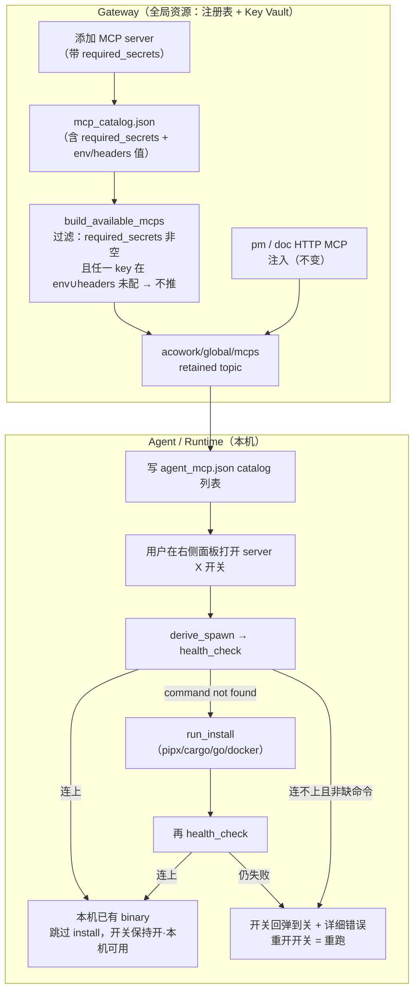

# ADR-090: MCP 安装动作下沉到 Agent 首次启用——Gateway 保留全局注册表与 Key Vault

**状态**：已接受（2026-10-10 实施完成）
**日期**：2026-10-09
**决策者**：Nicholas（方案确认）

> 文件名 slug `mcp-lsp-install-ownership-node` 为历史遗留：本 ADR 原与 LSP 合并、拟将注册表整体下沉到 Node。经评审拆分——LSP 部分独立为 [ADR-091](./ADR-091-lsp-server-registry-node.md)，MCP 部分按「Gateway 保留注册表、安装下沉到 Agent」的新模型重写为本文件。保留原文件名以免破坏既有链接。

**关联**：
- [ADR-055](./ADR-055-remote-runtime-node-topology.md)（§6.1 职责表——本 ADR **维持**「MCP 属 Gateway 全局资源」的定性，**不再修正**；原 ADR-090 拟将其下沉 Node 的结论作废）
- [ADR-072](./ADR-072-mcp-install-package-spec.md)（声明式 `McpPackageSpec`——本 ADR **继承**其全部决策，仅将 install 命令的**执行位置**从 Gateway 进程改到 Agent 进程）
- [ADR-069](./ADR-069-mcp-tool-level-optin.md)（MCP 工具级 opt-in——`active_server_names` 语义不变）
- [ADR-091](./ADR-091-lsp-server-registry-node.md)（LSP server 注册表下沉 Node——与本 ADR 同期拆分，MCP/LSP 走**不同**模型，理由见 §4.4）

---

## 1. 决策摘要

### 1.1 一句话

把「安装」这一**命令式、本机**动作从 Gateway 进程下沉到 **Agent（Runtime）进程**，在 Agent **首次启用**某个 MCP server 时执行；Gateway **保留完整 MCP 注册表与 API Key Vault**，职责收敛为「添加 server + 维护 key」两件事，不再有安装操作。推送策略从「仅已安装才推」改为「除『需要 key 但未配置』外全推」。「装没装」不持久化布尔状态，由 `health_check` 探测（PATH 即本机天然共享状态），从而实现「本机装一次、后续 Agent 免装」。**注册表不搬到 Node**——原始 bug（Gateway 装到本机、远程 Node 的 Runtime spawn 找不到 binary）由「安装发生在 Agent 所在机器」自然修复，无需 Node 侧 MCP 文件、API 或反代。

### 1.2 关键决策表

| # | 决策 | 内容 |
|---|------|------|
| D1 | Gateway 职责收敛 | Gateway 保留完整 MCP 注册表 + API Key Vault，仅做「添加 server」「维护 key」两件事；**删除** Gateway 侧安装执行（`install_server` 等）。MCP 仍是 ADR-055 §6.1 的 Gateway 全局资源 |
| D2 | 三关注点分离 | 注册表（声明式、全局、Gateway）／安装动作（命令式、本机、Agent 进程）／安装状态（本机事实、PATH 即状态、无状态文件）三者各归其位，不再捆绑下沉 Node |
| D3 | 推送过滤策略变更 | `required_secrets` 非空**且**其中有任一 key 在 `env ∪ headers` 未配置 → **不推**；其余（无需 key 的 + 已配全 key 的）全部推给 Agent。取代原「仅 `install.state==Installed` 才推」 |
| D4 | 后端新增 `required_secrets` 字段 | `McpServerConfigDef.required_secrets: Vec<String>`（[protocol.rs:1674](../../../core/acowork-core/src/protocol.rs#L1674)）。当前「需要哪些 key」只硬编码在前端 [mcp-presets.ts](../../../apps/acowork-desktop/src/lib/mcp-presets.ts)，后端完全不知道；Gateway 侧要过滤就必须先让 catalog 知道。**这是本 ADR 唯一的新增 schema**。命名用 `secrets` 而非 `env`：key 位置随 transport 而变（stdio 在 `env`、自定义 HTTP 在 `headers`），过滤时每个 key 名在 `env ∪ headers` 解析，复用既有 `extract_api_key_from_mcp_config`（[resource_cache.rs](../../../core/acowork-gateway/src/resource_cache.rs)）同时扫 env+headers 的约定，不新增第二个字段 |
| D5 | 安装下沉 + health_check-first + 开关触发 | **触发时机**：用户在右侧面板**打开某 MCP 开关**时触发（纳入 `active_server_names` 即 ensure usable）。顺序：`derive_spawn` → `health_check`（直接 spawn）→ 连上即视为本机已有、跳过 install；spawn 失败（command not found）→ `run_install` → 再 `health_check`。**倒转**当前 Gateway「无条件先 install」的顺序 |
| D6 | 失败即不可启用 + 详细错误 + 状态不持久化 | 最终失败 → **MCP 打不开（开关回弹到关）**，不静默；返回**详细错误**（缺哪个运行时/依赖、install 命令 stderr 摘要）引导用户解决环境依赖。再次打开开关 = 重跑整套流程。不持久化布尔 `install_state`，UI 态（探测中／本机可用／需安装／失败）全由 `health_check` 驱动；「本机装一次免装」靠的是 PATH 这个**跨 Agent 天然共享**的本机事实，不需要状态文件或跨进程同步 |
| D7 | 不加机器级安装锁 | 不引入自研锁（标记文件锁有「agent 崩了永久卡死」风险）。依赖 pipx venv 锁 / cargo package-cache 锁 / docker 内容寻址自带并发保护；且 health_check-first 把竞态窗口压到「本机首次、真没装过」的一次性事件。残留竞态**显式接受** |
| D8 | script kind 不进自动路径 | 当前无任何 `assets/mcp_install/*.sh`，preset 全是 npm/uvx/pipx/cargo/go。首次启用只跑 `derive_install_command`（[install.rs:257](../../../core/acowork-mcp/src/install.rs#L257)），不执行任意 shell |
| D9 | 保留 `mcp_install`/`mcp_uninstall` 工具 | Agent 自主安装自己 MCP 的能力**不删**——它写 `agent_mcp.json` 的 `local` 列表，与 Gateway 推送的 `catalog` 是两条独立路径，互不依赖 |
| D10 | 安装状态 UI 迁移 | 安装状态从「设置菜单」移到「右侧工具面板 MCP 列表」，展示 health_check 驱动的三态 |
| D11 | Runtime 无需 `--node-data-dir` | 相比原 ADR-090，Runtime 不再需要 node_data_dir 管 MCP（没有 Node 级 MCP 文件要读） |
| D12 | Gateway install 端点退役 | `mcp_catalog_api.rs` 的 `install_server`(:895)、`install_check`(:953)、`install_catalog_entry`(:999) 删除；`add/update/list/remove/probe` 保留（注册表 CRUD 仍在 Gateway） |
| D13 | Key 交付通路不变 | API key 沿用现有 `mcp_key_vault` / `auth_token` 内存交付通路（[resource_cache.rs](../../../core/acowork-gateway/src/resource_cache.rs) `build_mcp_key_vault`），不持久化到 Agent 磁盘；`pm`/`doc` HTTP MCP 注入逻辑不变 |
| D14 | LSP 不在本 ADR 范围 | LSP 走 [ADR-091](./ADR-091-lsp-server-registry-node.md) 的「注册表下沉 Node」模型；二者差异见 §4.4 |

---

## 2. 背景与现状事实

### 2.1 原始 bug（本 ADR 要解决的真问题）

stdio MCP server 由 Runtime `fork/exec`，binary 必须与 Runtime **同机**。当前流程是：用户在 Gateway 设置页点「安装」→ Gateway 进程（[mcp_catalog_api.rs:895](../../../core/acowork-gateway/src/http/mcp_catalog_api.rs#L895) `install_server` → `run_install_pipeline`:785）在 **Gateway 所在机器**跑 `pipx install` / `cargo install` → binary 落到 Gateway 机器的 PATH。当 Runtime 被 Node 调度到**另一台机器**时，spawn 找不到 binary。

> 原 ADR-090 的解法是「把注册表整体搬到 Node」。本 ADR 的解法是「把安装动作搬到 Agent 进程」——Agent 在哪台机器就把 binary 弄到那台，bug 同样消失，且改动面小得多。

### 2.2 当前 install 语义：查的是 runtime，不是包

- `probe_runtime`（[install.rs:71](../../../core/acowork-mcp/src/install.rs#L71)）只检查**运行时**是否存在（pipx/cargo/uvx 有没有），**不检查具体包**（docling 装没装它不知道）。
- 当前 `install_server` 一旦触发就**无条件** `run_install`（[mcp_catalog_api.rs:907](../../../core/acowork-gateway/src/http/mcp_catalog_api.rs#L907)），不先探测 binary 是否已在。
- `health_check`（[install.rs:339](../../../core/acowork-mcp/src/install.rs#L339)）做 spawn + initialize + tools/list，返回工具数。**它本身就是「binary 在不在、能不能用」的可靠探测**。

→ 这两点决定了 D5 必须把顺序倒成 health_check-first，否则「本机装一次免装」会退化成「每个 Agent 重跑分钟级 `cargo install`」。

### 2.3 「需要哪些 key」现状：前端硬编码，后端不可见

| 事实 | 位置 |
|------|------|
| 「哪些 server 需要哪个 API Key」= 前端手写的 `requiredEnv` 数组 | [mcp-presets.ts](../../../apps/acowork-desktop/src/lib/mcp-presets.ts)（如 `brave-search → ["BRAVE_API_KEY"]`） |
| 前端类型定义 | [types.ts:2260](../../../apps/acowork-desktop/src/lib/types.ts#L2260) `McpPresetDef.requiredEnv` |
| 后端 `McpServerConfigDef` | **无**对应字段（[protocol.rs:1674](../../../core/acowork-core/src/protocol.rs#L1674)） |
| 后端全仓 `grep required_env` | **零命中** |

后端 catalog 只存 `env`（用户填进去的**真实 key 值**），靠 `key/token/secret/password` 关键词启发式做掩码显示（[mcp_catalog_api.rs:387](../../../core/acowork-gateway/src/http/mcp_catalog_api.rs#L387)），但**不知道该配哪些 key**。故 D3 的过滤必须在 Gateway 侧做，而 Gateway 侧要过滤就得先补 D4 的字段。

### 2.4 推送通路现状（保留，仅改过滤）

`acowork/global/mcps` retained topic 由 [global_resources_builders.rs:258](../../../core/acowork-gateway/src/mqtt/global_resources_builders.rs#L258) `build_available_mcps` 构建：读 catalog 提取 env/headers → 组 `McpRef` 列表 → **额外注入 Gateway 托管的 `pm`/`doc` HTTP MCP**（`pm_mcp_url`/`doc_mcp_url` 存在时）。Runtime 侧 `mqtt/client.rs` 收到后写 `agent_mcp.json` 的 `catalog` 列表（[agent_config.rs:892](../../../core/acowork-runtime/src/agent_config.rs#L892) `save_agent_mcp_config_catalog`）。

> 本 ADR **保留整条通路**，只在 `build_available_mcps` 加 D3 过滤。`pm`/`doc` 注入不动——它们是 HTTP、无需 install，天然满足「不需要 key 就推」。

### 2.5 Runtime 无 Node HTTP 通道（关键约束）

`grep 19900|node.*http core/acowork-runtime/src/` **零命中**：Runtime 只连 Gateway（MQTT + localhost HTTP），**不直连 Node**。这排除了「Agent 调 Node API 让它代装」的方案（需新建 Runtime→Node 链路），反向印证 D5「Agent 进程自己 exec pipx」是最省链路的选择——Runtime 已链接 `acowork-mcp`（Cargo.toml），`run_install`/`health_check` 可直接调用，且 Runtime 进程继承 Node 机器的 PATH/env。

---

## 3. 备选方案

| 方案 | 描述 | 否决理由 |
|------|------|----------|
| **A（原 ADR-090）** | 注册表整体下沉 Node，Gateway 纯反代，Node 持 `mcp_servers.json` + MCP API | 改动面大（Node 文件+API+反代+迁移）；违反 ADR-055 §6.1「MCP 属 Gateway 全局资源」；引入 3 个 Blocker（pm/doc 消失、迁移跨机、`--node-data-dir` 打断 standalone）。**本 ADR 取代 A** |
| **B** | Gateway 继续装，但装完把 binary 分发到各 Node | 需要跨机 binary 传输 + 各包管理器 per-machine 状态同步，复杂度爆炸；YAGNI |
| **C（本 ADR）** | 注册表/Key 留 Gateway，安装下沉 Agent 首次启用，PATH 即状态 | **采纳** |
| **D** | 安装下沉 Node（Agent 调 Node API 代装） | Runtime 无 Node HTTP 通道（§2.5），需新建链路；且 Node 只是 per-machine 守护，让它持有安装逻辑不若让真正要用的 Agent 进程自装直接 |

---

## 4. 决策理由

### 4.1 关注点分离优于整体搬迁
「有哪些 server + 要哪些 key」是**声明式、全局**知识，天然属 Gateway 全局资源；「把 binary 弄到这台机器」是**命令式、本机**动作，天然属 Agent 进程。原 ADR-090 把两者捆在一起搬到 Node，是为了修「安装位置错」这一个 bug——但 bug 的根因只是**安装动作**跑错了机器，注册表跑 Gateway 从没错过。只搬动作、不搬注册表，bug 同样修好，边界反而更干净。

### 4.2 PATH 即状态：免装机制零新存储
「本机装一次、下个 Agent 免装」不需要跨 Agent 同步的 `install_state` 文件——binary 在不在 PATH，`health_check` spawn 一下就知道。D5 的 health_check-first 把这个天然共享状态直接当作安装判据，省掉 ADR-090 的 Node 状态文件、合并规则、原子写、权限管理一大套。

### 4.3 改动面最小
保留：MCP 注册表、`acowork/global/mcps` 推送、`pm`/`doc` 注入、`mcp_install`/`mcp_uninstall` 工具、Key Vault 交付通路。删除：Gateway install 执行端点。新增：1 个 schema 字段 + 1 处推送过滤 + Runtime 首次启用逻辑 + UI 状态位置。Node 侧 MCP 相关**整段不做**。

### 4.4 为什么 LSP 不走同一模型（与 ADR-091 的分野）

| 维度 | MCP | LSP |
|------|-----|-----|
| 产物形态 | spawn 即用的包（binary 在 PATH 就能起） | 常驻 sidecar（要监听、要 relay 转发，非「spawn 一下」） |
| 状态探测 | `health_check` spawn 即探 | 无「PATH 即状态」等价物，需显式注册表 + 进程生命周期 |
| 归属结论 | 安装下沉 Agent，注册表留 Gateway | 注册表下沉 Node（ADR-091） |

LSP server 是要 Node 长期托管的 sidecar 进程，其「装没装/跑没跑」是 Node 的进程事实，必须有个 Node 级权威；MCP server 是 Agent 用时才 spawn 的子进程，其「装没装」是 PATH 事实，无需权威文件。故二者拆开。

---

## 5. 详细设计

### 5.1 端到端流程（新模型）



### 5.2 schema 变更（D4）

```rust
// core/acowork-core/src/protocol.rs — McpServerConfigDef
pub struct McpServerConfigDef {
    // ... 现有字段不变 ...
    /// Secret names this server REQUIRES to be usable (e.g. API keys).
    /// Populated from the frontend preset at "add server" time and persisted
    /// in the Gateway catalog. Gateway's `build_available_mcps` skips pushing
    /// an entry whose required_secrets is non-empty while any required name is
    /// missing/empty across BOTH `env` and `headers` (stdio keys live in env,
    /// custom HTTP keys live in headers — same lookup convention as
    /// `extract_api_key_from_mcp_config`). Empty vec => usable without secret.
    #[serde(default)]
    pub required_secrets: Vec<String>,
}
```

- 前端「添加 server」时把 `preset.requiredEnv` 一并 POST 进 catalog（[mcp_catalog_api.rs:453](../../../core/acowork-gateway/src/http/mcp_catalog_api.rs#L453) `add_catalog_entry` 接收）。preset 的 `requiredEnv` 语义即「必需 secret 名」，stdio 类填 env 名、自定义 HTTP 类填 header 名。
- `#[serde(default)]` 保证旧 catalog 文件无该字段时按「不需要 key」处理，向后兼容。

### 5.3 推送过滤（D3）

在 `build_available_mcps`（[global_resources_builders.rs:258](../../../core/acowork-gateway/src/mqtt/global_resources_builders.rs#L258)）构建 `McpRef` 列表处，对每个 catalog entry 增加判定。key 值在 `env ∪ headers` 查找（与 `extract_api_key_from_mcp_config` 一致）：

```
fn secret_configured(entry, name) -> bool {
    entry.env.get(name).or(entry.headers.get(name))
        .map(|v| !v.trim().is_empty()).unwrap_or(false)
}

if !entry.required_secrets.is_empty()
   && entry.required_secrets.iter().any(|k| !secret_configured(entry, k)) {
    skip  // 需要 key 但未配全 → 不推给 Agent
}
```

`pm`/`doc` 注入分支不受影响（它们 `required_secrets` 为空或走独立注入）。

### 5.4 首次启用安装逻辑（D5，Runtime 侧）

Runtime 新增「ensure server usable」例程（复用 `acowork-mcp`，无新依赖）：

```
fn ensure_usable(name, pkg, spawn, env):
    // 1. 先探（PATH 即状态）
    match health_check(spawn).await:
        Ok(_) => return Usable          // 本机已有，免装
        Err(command_not_found) => {}     // 继续装
        Err(other) => return Failed(other)   // 连不上且非缺命令 → 直接失败带原因
    // 2. 装（仅 derive_install_command，无 shell）
    match run_install(pkg).await:        // install.rs:301
        Ok(_) => {}
        Err(e) => return Failed(e)        // 安装失败：透传 stderr 摘要
    // 3. 复探
    match health_check(spawn).await:
        Ok(_) => return Usable
        Err(e) => return Failed(e)
```

- **触发时机**：用户在右侧面板**打开某 MCP 开关**（纳入 `active_server_names`，ADR-069 opt-in）时同步触发 ensure。开关态 = ensure 结果：`Usable` 才保持打开，`Failed` 则**开关回弹到关**并显示错误。
- **失败即不可用**：不静默降级。`Failed` 必须携带**详细错误**——缺哪个运行时（pipx/cargo/docker 未装）、install 命令的 stderr 摘要、health_check 握手失败原因——供用户自行修复环境依赖。
- **重试 = 重开开关**：不缓存失败态；用户再次打开开关即重跑整套流程（大概率仍失败，故错误信息质量是关键）。
- npm/uvx 类 `derive_install_command` 返回 `None`（`npx -y`/`uvx` 懒解析）→ 跳过步骤 2，直接靠步骤 1 的 health_check（首次 spawn 会触发 npx 下载）。
- 并发（D7）：不加锁，靠包管理器自带锁 + 一次性窗口。

### 5.5 UI（D10）

- 移除设置菜单里的安装状态区。
- 设置页为**单一列表、两类行**：preset 行常驻（未添加 → 「添加」，已添加 → 「已添加」，**无 Remove**——内置模板的注册表副本不是用户可删对象）；custom 行（不属于任何 preset 的 catalog 条目）带 Remove。两类行都**无 Test 按钮**（见 §5.6，运行时探测不属于 Gateway）。
- 右侧工具面板 MCP 列表每项显示 health_check 驱动的状态：`探测中 / 本机可用 / 需安装 / 失败(详细原因)`。措辞用「**本机可用**」而非「本 Agent 已安装」——binary 是全机共享事实，避免误导。
- 失败态展示详细错误（运行时缺失/依赖/install stderr 摘要），并提供「重试」（= 重新打开开关）。
- 「需要哪些 key」的展示仍可用前端 preset（`requiredEnv`），但**过滤判定的真相在 catalog**（D4 `required_secrets`），二者需对齐。

### 5.6 删除项（D12）

| 删除 | 位置 |
|------|------|
| `install_server` | [mcp_catalog_api.rs:895](../../../core/acowork-gateway/src/http/mcp_catalog_api.rs#L895) |
| `install_check` | [mcp_catalog_api.rs:953](../../../core/acowork-gateway/src/http/mcp_catalog_api.rs#L953) |
| `install_catalog_entry` | [mcp_catalog_api.rs:999](../../../core/acowork-gateway/src/http/mcp_catalog_api.rs#L999) |
| `run_install_pipeline` | [mcp_catalog_api.rs:785](../../../core/acowork-gateway/src/http/mcp_catalog_api.rs#L785) |
| `/api/mcp-catalog/install*` 路由 | [mcp_catalog_api.rs:43-46](../../../core/acowork-gateway/src/http/mcp_catalog_api.rs#L43) |

`probe_server_config`/`probe_catalog_entry` 及 `/api/mcp-catalog/probe*` 路由**一并删除**。原拟「保留作 Gateway 侧添加时预检」与 D1 自相矛盾：Gateway 进程 probe stdio server 是在 **Gateway 所在机器** spawn，与「binary 必须在 Agent 所在机器」是同一个 bug 类；多 Node 时「测哪个 Node」根本没有答案。server 可用性由 Agent 在首次启用时验证（§5.4），设置页不做任何运行时探测。

---

## 6. 对既有 ADR 的影响

| ADR | 影响 |
|-----|------|
| ADR-055 §6.1 | **维持**「MCP 属 Gateway 全局资源」——原 ADR-090 拟修正的结论作废，无需改 ADR-055 |
| ADR-072 | **继承**全部决策；仅 install 命令执行位置由 Gateway 进程改到 Agent 进程（§2.1/§4.1），声明式 spec 不变 |
| ADR-069 | `active_server_names` 语义不变；首次启用即「纳入 active 且 ensure usable」 |
| ADR-091 | LSP 独立走「注册表下沉 Node」，与本 ADR 分野见 §4.4 |

---

## 7. 后果

### 7.1 正面
- 原始远程 Node spawn bug 消失（安装在 Agent 所在机器发生）。
- 改动面远小于原 ADR-090：无 Node MCP 文件/API/反代、无迁移、无 `--node-data-dir`。
- Gateway 边界回归 ADR-055 全局资源定性；pm/doc 注入不受影响。
- 「本机装一次免装」靠 PATH 天然共享，零新增存储。
- Agent 自主安装能力（`mcp_install`）保留。

### 7.2 负面与代价
- 新增 1 个 schema 字段 `required_secrets`（唯一实质数据模型改动）。
- Runtime 进程获得执行包管理器（pipx/cargo/docker）的能力——权限面扩大（但 `mcp_install` 工具本已具备，非新增攻击面）。
- 安装状态是 per-agent 视图；同机两 Agent 的 health_check 结果理论上可能短暂不一致（一个刚探、一个未探），但都指向同一 PATH 真相，最终收敛。

### 7.3 风险（含缓解）

| 风险 | 缓解 |
|------|------|
| 同机并发首次启用同包 → 双跑 install | 靠 pipx/cargo/docker 自带锁；窗口为「本机首次、真没装过」一次性事件；显式接受（D7） |
| `cargo install` 重编译分钟级 | health_check-first 已规避：binary 在则直接连上、不重跑 |
| 前端 `requiredEnv` 与 catalog `required_secrets` 漂移 | D4 让 catalog 成过滤真相；添加时写入，UI 展示对齐 catalog |
| 旧 catalog 无 `required_secrets` | `#[serde(default)]` → 视为不需 key，向后兼容 |

---

## 8. 迁移与回滚

- **迁移**：无数据迁移。旧 catalog 缺 `required_secrets` 按默认（不需 key）处理，行为等价于「全部照常推」，不破坏现有 Agent。前端在下次「添加/编辑 server」时自然补齐 `required_secrets`。
- **回滚**：D4 字段带 `#[serde(default)]`，回滚代码后旧字段被忽略、无 schema 破坏；Gateway install 端点删除是唯一不可逆动作——若需回滚，恢复 `install_server` 即可，注册表/推送通路始终未动，回滚成本低。

---

## 9. 实施边界

| 阶段 | 内容 | 涉及文件 |
|------|------|----------|
| P0 | `McpServerConfigDef` 加 `required_secrets`；前端 add/edit 写入 | `protocol.rs`、`mcp_catalog_api.rs::add_catalog_entry`、前端 add-server flow |
| P1 | `build_available_mcps` 加 D3 过滤 | `global_resources_builders.rs:258` |
| P2 | Runtime 开开关触发 ensure-usable（health_check-first → run_install → 复探；失败回弹 + 详细错误） | `acowork-runtime`（新增例程，复用 `acowork-mcp::install`） |
| P3 | 删除 Gateway install 端点 + 路由 | `mcp_catalog_api.rs` |
| P4 | UI 安装状态从设置菜单移到右侧面板 | 前端 HarnessPage / 工具面板 |
| P5 | 回归测试：远程 Node spawn、并发首次启用、旧 catalog 兼容 | `dev/ci.sh` + 集成测试 |

**不做**：Node 级 `mcp_servers.json`、Node MCP API、Gateway→Node MCP 反代、`--node-data-dir`、per-agent `install_state` 持久化、机器级安装锁、script kind 自动路径。

---

## 10. 已定决策（原开放问题，评审拍板）

1. **触发时机 = 打开开关时**：用户在右侧面板打开某 MCP 开关（纳入 `active_server_names`）时同步触发 ensure，触发即显示安装状态。`cargo install` 等耗时操作走 async + UI「探测中/安装中」态，不阻塞交互。见 D5/§5.4。
2. **失败即不可启用 + 详细错误 + 重开重试**：ensure 最终失败 → 开关回弹到关、不静默，返回详细错误（缺哪个运行时/依赖、install stderr 摘要、握手失败原因）供用户自行解决环境依赖；再次打开开关 = 重跑整套流程。见 D6/§5.4。
3. **过滤覆盖 `env ∪ headers`**：字段命名 `required_secrets`（非 `required_env`），每个 key 名在 `env ∪ headers` 解析，复用既有 `extract_api_key_from_mcp_config` 同时扫两处的约定——stdio key 在 env、自定义 HTTP key 在 headers，一并覆盖，不新增第二个字段。`pm`/`doc` 平台自托管无 key，不受影响。见 D3/D4/§5.3。
4. **UI 措辞 = 「本机可用」**：binary 是全机共享事实，状态显示「本机可用」而非「本 Agent 已安装」，避免误导。见 D6/§5.5。
