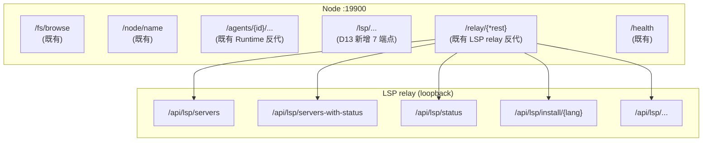

# ADR-091: LSP Server 注册表下沉到 Node — preset ∪ custom 合并、install state 持久化

**状态**：提议（待评审）
**日期**：2026-10-09
**决策者**：待评审
**关联**：
- [ADR-019](./ADR-019-lsp-relay-standalone-process.md)（LSP relay 解耦为独立进程）
- [ADR-030](./ADR-030-sidecar-endpoint-dynamic-push.md)（Sidecar 端点动态推送）
- [ADR-055](./ADR-055-remote-runtime-node-topology.md)（§6.7 Sidecar Scope 模型）
- [ADR-087](./ADR-087-node-agent-owner-permissions.md)（Node 归属门控；custom/install 走 manage 权限）
- [ADR-089](./ADR-089-lsp-relay-reachability-vs-exposure.md)（D2 Gateway → Node → LSP relay 反代）
- [ADR-090](./ADR-090-mcp-lsp-install-ownership-node.md)（同期拆分；本 ADR 是其 LSP 部分的独立演进）

---

## 1. 决策摘要

### 1.1 一句话

LSP server 的 install 与 spawn 同在 Node 本机（`rustup component add rust-analyzer` / `pip install python-lsp-server` 等产物在 Node 文件系统），因此 **server 注册表的权威源在 Node**，不在 Gateway。Gateway 退化为纯反代。

`assets/lsp_servers.json` 改为**只读 preset**（随套件分发，运行时 MUST NOT 写）；新增 `{node_data_dir}/lsp_servers.json` 作为**唯一运行时真相**（preset ∪ custom ∪ install state），Node 启动时合并、运行时读写。

### 1.2 与 ADR-090（MCP）的边界

| 维度 | ADR-090 MCP | ADR-091 LSP（本 ADR） |
|------|------------|---------------------|
| 现有 registry 位置 | Gateway 持 `mcp_catalog.json` | Node 已有 `acowork/nodes/{id}/lsps` topic 上行，Gateway 仅消费 |
| 待迁出的真相源 | Gateway 侧 catalog + list + key_vault | 无遗留；现状仅读 preset |
| `acowork/global/<thing>` topic 推 push | 活路径（含 pm/doc 托管 MCP） | 已废弃（[node_registry.rs:35-46](../../core/acowork-gateway/src/mqtt/node_registry.rs#L35)） |
| install 耗时 | MCP `pipx install` 分钟级 | LSP `pip install` 秒级 |
| 跨进程真相 | Gateway↔Node 同步（**评审 Blocker 候选**） | Node 内部一进程（无跨进程） |
| Runtime 是否知情 | Runtime 直读 mcp_servers.json | Runtime 不参与 LSP，**LSP 与 Runtime 物理隔离** |
| 迁移成本 | 一次性拆 catalog → 多 Node | **无迁移**——custom server 从未支持过 |

> 结论：LSP 比 MCP 简单一档——没有跨进程真相同步、没有 Gateway 托管 LSP、没有 Runtime 参与、没有遗留数据可迁。**本 ADR 的全部风险在 Node 进程内部**。

### 1.3 关键决策表

| # | 决策 | 内容 |
|---|------|------|
| D1 | preset 只读、随套件安装 | `assets/lsp_servers.json` + `assets/lsp_install/`（现状不变），运行时 MUST NOT 写 |
| D2 | runtime 文件为唯一真相 | `{node_data_dir}/lsp_servers.json` = preset ∪ custom ∪ install state 三合一 |
| D3 | 路径域区分、不引入后缀 | runtime 文件与 preset 同名 `lsp_servers.json`，靠目录区分（`assets/` vs `{node_data_dir}/`） |
| D4 | Node 平铺 | 遵循 `{node_data_dir}` 现有约定（`identity.json` / `state.json` / `packages/` / `logs/` / `runtime-logs/` 全平铺），新增 `lsp_servers.json` 同层放置 |
| D5 | `source` 字段持久化 | 每条目携带 `source: "preset" \| "custom"`，用于 UI 分组与合并判定 |
| D6 | 合并规则：元数据刷新、实例与状态保留 | preset 升级刷新 `candidates/args/description/install_hint/install_script/root_markers`；保留用户 `candidate_args` 与 `install_state` |
| D7 | 不做 reset-to-preset | 不提供「恢复 preset 默认值」入口；用户改错自行改回 |
| D8 | 文件权限 0600 + 原子写 | runtime 文件 MUST `tmp + fsync + rename`；POSIX 0600，Windows 走 ACL 或降级 no-op + warn |
| D9 | install state 持久化 | install 完成后写 `install_state` 段；重启不再全量重探（改为启动一次校验 + 用户显式 Refresh） |
| D10 | `installing` 不持久化 | 进程崩溃后无残留 `installing`；in-flight 仅存内存，丢失即下次重试 |
| D11 | Node 单一写者 | Node 内存态为唯一读写入口（`Arc<RwLock<LspServersFile>>`），所有 handler 在写锁内 mutate + 单点 `save()`；install 串行由 `LspInstallGuard` 保护 |
| D12 | LSP relay 重启模型 | 配置变更（含 preset 升级、custom 增删）触发 LSP relay 进程重启（supervisor 接管）；relay 自身无热重载（`OnceLock` 单次加载） |
| D13 | Node 端 API 契约 | Node HTTP server 在 `/lsp/...`（无 `/api` 前缀，与 `/fs/browse` / `/node/name` 既有约定一致）暴露 7 端点；Gateway 经 `/api/nodes/{id}/lsp-admin/{*tail}` 反代（不复用现有 `/api/nodes/{id}/lsp/{*tail}` 透传路径） |
| D14 | ADR-087 门控 | custom LSP server 创建、`/install` 执行需经 Node-manage 权限（install_script 是任意 shell，manage 是必要门槛） |

---

## 2. 背景与现状事实

### 2.1 LSP 物理链路（参照系）

| 阶段 | 位置 |
|------|------|
| preset 元数据 | `assets/lsp_servers.json`（version 1，12 个内置：`rust` / `python` / `typescript` / `go` / `c` / `json` / `yaml` / `html` / `css` / `markdown` / `java` / `kotlin`） |
| install 脚本 | `assets/lsp_install/{rust,python,typescript,go,clangd,json,yaml,markdown,kotlin,java,css,html}.{sh,ps1}`（12 套） |
| dev 拷贝 | `apps/acowork-desktop/src-tauri/build.rs:142-156` → `target/{profile}/bin/` |
| release 打包 | `apps/acowork-desktop/src-tauri/tauri.conf.json:58` `bundle.resources` 映射 |
| 定位注入 | `apps/acowork-desktop/src-tauri/src/commands/gateway.rs:545` `env("ACOWORK_LSP_CONFIG_DIR", resource_dir)` |
| 加载候选 | [`core/acowork-lsp-relay/src/config.rs::build_config_candidates()`](../../core/acowork-lsp-relay/src/config.rs)：`$ACOWORK_LSP_CONFIG_DIR` → `$CARGO_MANIFEST_DIR/../../assets` → `exe_dir` → `cwd` |
| fallback | `builtin_lsp_defaults()`（[config.rs:239](../../core/acowork-lsp-relay/src/config.rs#L239)） |
| 端点转发 | Gateway `lsp_proxy.rs:49` `/api/nodes/{id}/lsp/{*tail}` → Node `/relay/{*tail}`（[proxy/mod.rs:66](../../core/acowork-node/src/proxy/mod.rs#L66)）→ LSP relay loopback |

### 2.2 LSP 现状缺的两项能力（本次修正目标）

1. **不能新增 server**——`LspServerEntry` schema 已完整（[config.rs:24-44](../../core/acowork-lsp-relay/src/config.rs#L24)），但只有 `assets/lsp_servers.json` 的 override 入口，**没有 user-side 新增 key 的能力**。「preset ∪ custom 合并」问题从未暴露。
2. **install state 不持久化**——`RwLock<LspServersWithStatus>` 内存态（[config.rs:91](../../core/acowork-lsp-relay/src/config.rs#L91)），每次重启重新探测 12 个 LSP binary。custom server 引入后这个缺陷会被放大（用户自写 install script 可能分钟级）。

### 2.3 LSP install 与 spawn 的真实语义

- **install** = 安装 language server 二进制（`rustup component add` / `pip install python-lsp-server` / `npm install -g typescript-language-server` 等）；产物在 Node 文件系统
- **spawn** = LSP relay 按需 `tokio::process::Command::new(candidate)` 拉起（[config.rs:1226](../../core/acowork-lsp-relay/src/config.rs#L1226) `probe_one`）；在 Node 进程内执行
- 与 MCP 的 `kind=="script"` 不同：LSP install 全部走**套件内脚本**（`assets/lsp_install/*.sh`），**没有"用户粘贴 shell 字符串"的概念**（详见开放问题 Q1）

### 2.4 `acowork/nodes/{node_id}/lsps` 已就位

`core/acowork-gateway/src/mqtt/node_registry.rs:35-46` 注释：LSP server 列表走 **per-node retained topic**，deprecated 的 `acowork/global/lsps` 已下线。`AvailableLsps` envelope 由 Node 上报（含 `lsp_endpoint` 用于 health probe），Gateway 只消费不生产。**本 ADR 不需要新增 Gateway→Node 推送通道**，是单向的"Node → Gateway"事实广播。

### 2.5 `LspTab` UI 已按 Node 过滤

[`apps/acowork-desktop/src/components/harness/LspTab.tsx:106-166`](../../apps/acowork-desktop/src/components/harness/LspTab.tsx#L106) 已有 Node picker（`relayNodes` 状态、`effectiveNodeId` 解析、`fetchNodes()` 拉候选）；通过 ADR-089 D2 反代读 `relayUrl/api/lsp/servers` 与 `servers-with-status`。**本 ADR 仅扩展 LspTab 的能力面（custom server、Refresh 按钮、install state 列），不重构 Node 选择器。**

### 2.6 `{node_data_dir}` 现状

`core/acowork-node/src/cli.rs:60-62`：`--data-dir`（alias `--work-dir`，env `ACOWORK_NODE_HOME`），默认 `$HOME/.acowork/acowork-node`。实测内容：

```
identity.json  state.json  packages/  logs/  runtime-logs/
```

无 `data/` 子目录。**D4 据此选择平铺。**

---

## 3. 备选方案

| 方案 | 描述 | 否决理由 |
|------|------|---------|
| A. Gateway 持 LSP registry + 派发 install | 仿 MCP 旧方案 | LSP install 产物在 Node；Gateway 持 registry 必导致双源；且 Node 端已有 `acowork/nodes/{node_id}/lsps` 上行通路，再加一条 Gateway→Node 推送是 A 类反模式 |
| B. `custom` 走 per-agent 目录 | 放在 `{work_dir}/lsp_servers.json` | LSP 是 Node 全局资源（与语言绑定，与 agent 无关），per-agent 目录会跨 agent 重复 install；且 `{work_dir}` 在多 user 场景下被 ADR-087 隔离，不是 Node 全局视图 |
| **C. 本 ADR** | preset 只读 + Node runtime 文件唯一真相 + Gateway 纯反代 | — |

---

## 4. 决策理由

1. **install 与 spawn 同机是硬约束**。LSP relay 在 Node 进程内 `Command::new` 拉起 language server，二进制必须在 Node 文件系统。
2. **单源优于双源**。`acowork/nodes/{node_id}/lsps` 已是 Node 权威上行；runtime 文件与它一致后，Gateway 仅在 `lsp_endpoint` health probe 上消费。
3. **LSP 链路已被验证**。`build.rs` 拷贝、tauri 资源映射、`ACOWORK_LSP_CONFIG_DIR` env 注入、supervisor 拉起、Gateway 反代——五段全有现成实现，本次复用而非发明。
4. **install state 持久化的价值**。当前每次 gateway / node 重启都全量 `probe_all`（12 个 binary 的 PATH 检测，毫秒级），价值小；但 **custom server 的 install 路径**（用户自己写的 install script）会显著变慢且无幂等保护，持久化的价值大。
5. **LSP 与 MCP 拆开**。用户要求二者独立演进——MCP 涉及 Runtime / Gateway / Node 三方协同、LSP 仅在 Node 内部，**强行合写会让两份 ADR 的读者互相干扰**。

---

## 5. 详细设计

### 5.1 文件布局

```
安装目录（只读，随套件分发）
  assets/lsp_servers.json          # 现状不变（D1）
  assets/lsp_install/*.sh|*.ps1    # 现状不变

{node_data_dir}/                   # $HOME/.acowork/acowork-node
  identity.json                    # 现状
  state.json                       # 现状
  lsp_servers.json                 # 新增，唯一运行时真相（D2/D3）
  packages/  logs/  runtime-logs/  # 现状
```

**preset 候选路径不变**（`build_config_candidates()` 现有四档）。runtime 文件单点定位 `{node_data_dir}/lsp_servers.json`（Node 启动时合并生成；**不再依赖 env 注入**，比 preset 简单一档）。

### 5.2 schema

**preset（只读，`assets/lsp_servers.json`）**——现状不变：`version: 1, servers: IndexMap<String, LspServerEntry>`。

**runtime（读写，`{node_data_dir}/lsp_servers.json`）**——每条目三段：

```json
{
  "version": 1,
  "servers": {
    "rust": {
      "source": "preset",

      "candidates": ["rust-analyzer"],
      "args": [],
      "candidate_args": {},
      "install_hint": "rustup component add rust-analyzer",
      "install_script": "rust",
      "description": "Rust language server (defaults to stdio, no --stdio flag)",
      "root_markers": ["Cargo.toml"],

      "install_state": "installed",
      "installed_command": "rust-analyzer",
      "install_stdout": "...(截断 4 KB)",
      "install_stderr": "...(截断 4 KB)",
      "last_install_ms": 1762000000000
    },
    "my-team-lsp": { "source": "custom", "candidates": ["my-lsp"], "...": "..." }
  }
}
```

- `servers` MUST 为 `IndexMap`（LSP 已踩过 `HashMap` SipHash 随机种子坑，注释见 [config.rs:50-58](../../core/acowork-lsp-relay/src/config.rs#L50)）
- **元数据段**（`candidates` / `args` / `candidate_args` / `install_hint` / `install_script` / `description` / `root_markers`）来自 preset，preset 升级时刷新（D6）
- **实例段**（custom server 的实例段全段由用户填；preset server 的实例段用户可覆盖 `candidate_args`）
- **状态段**（`install_state` / `installed_command` / `install_stdout` / `install_stderr` / `last_install_ms`）由 install / health_check 写

`install_state` 取值沿用 LSP 现状：`unknown` / `detected`（已探测到 binary） / `installing`（in-memory only，**不持久化**，D10） / `installed` / `failed`。

### 5.3 合并规则

```
load_lsp_servers(node_data_dir, preset_registry):
  runtime = read({node_data_dir}/lsp_servers.json) or empty
  merged  = IndexMap::new()

  for (name, preset) in preset_registry.servers:           # 按 preset 顺序
    if name in runtime and runtime[name].source == "preset":
      merged[name] = merge(runtime[name], preset)           # 元数据段 ← preset 刷新
                                                         # candidate_args ← runtime 保留
                                                         # install_state ← runtime 保留
    else:
      merged[name] = LspServerEntry {
        source: "preset",
        元数据段: preset,
        install_state: "unknown",
      }

  for (name, entry) in runtime.servers:
    if entry.source == "custom" and name not in merged:
      merged[name] = entry                                  # custom 原样保留

  return merged
```

重名策略：preset 名与 custom 名冲突时**以已存在条目为准**（不静默覆盖）；UI 在「新增 custom」时校验名称唯一（沿用 LSP 现状的 `lsp_servers.json` 加载语义）。

### 5.4 写入与权限（D8 + D11）

```
save_lsp_servers(node_data_dir, servers):
  final = {node_data_dir}/lsp_servers.json
  tmp   = final.with_extension("json.tmp")
  write(tmp, serde_json::to_string_pretty(servers))
  f.sync_all()
  set_permissions(tmp, 0o600)          # POSIX；Windows 走 ACL 或降级 no-op + warn
  rename(tmp, final)                   # POSIX 原子
```

`install_stdout` / `install_stderr` 含安装过程的 npm/pip 输出，**可能夹带 token**（npm 私有 registry / pip index URL 嵌入 auth），0600 同样适用。

**Node 单一写者（D11）**：`Arc<RwLock<LspServersFile>>` 是 Node 内存态唯一真相；所有 Node HTTP handler 必须在写锁内 mutate map + 调用一次 `save()`。`LspInstallGuard` 降级为"同 name 不并发 install"的 UX 保护，**不再是并发正确性依赖**——`PUT /lsp/servers/{name}`（改 `candidate_args`）与 `POST .../install`（写状态段）并发会 lost update。

### 5.5 Node 端 API 与 Gateway 反代（D13）

**Node 侧（`:19900`，node token 鉴权，无 `/api` 前缀）**：

```
GET    /lsp/servers                       # preset ∪ custom ∪ state
GET    /lsp/servers-with-status           # 保留 LspServersWithStatus shape（不破坏 UI）
POST   /lsp/servers                       # 新增 custom（name 冲突 409）
PUT    /lsp/servers/{name}                # 改实例段（candidate_args / install_script / ...）
DELETE /lsp/servers/{name}                # 卸载记录（不删语言服务器产物）
POST   /lsp/servers/{name}/install        # 执行 install_script，写回 state
GET    /lsp/servers/{name}/install/status # in-flight 阶段（沿用 InstallStage 枚举）
GET    /lsp/presets                       # 只读 preset registry
```

**LSP relay 端点形状不变**：`/api/lsp/servers` 与 `/api/lsp/servers-with-status` 由 LSP relay 暴露在 loopback，Node 经 `/relay/{tail}` 反代透传。本 ADR 的 Node API **新增** 7 端点（不替换现有 LSP relay 端点），与 LSP relay 的 5 端点共存于 Node 路由树：



**Gateway 侧**：现有 `/api/nodes/{id}/lsp/{*tail}` → Node `/relay/{*tail}`（ADR-089 D2 路径，**LSP relay 端点透传，不变**）。**新增** 反代路由 `/api/nodes/{id}/lsp-admin/{*tail}` → `http://{node.proxy_endpoint}/lsp/{tail}`，注入 `X-ACOWORK-Node-Token`，复用 `http/proxy.rs` 既有转发机制。

> **路径前缀与既有约定的对齐**：Node 现有路由**无 `/api` 前缀**（`/fs/browse` / `/node/name` / `/agents/{id}/...`），故 Node 侧 API 用 `/lsp/...`。Gateway 侧用 `/api/nodes/{id}/lsp-admin/...`（与 ADR-089 D2 的 `/api/nodes/{id}/lsp/...` 同形但前缀不同），UI 与 `lspStore` 据此区分读 vs 写。

### 5.6 Node 端状态变更对 LSP relay 的传播（D12）

```
Node 启动:
  1. load + 合并 preset ∪ custom → 内存态
  2. save() 落盘 {node_data_dir}/lsp_servers.json
  3. spawn LSP relay（supervisor 接管，env ACOWORK_LSP_CONFIG_DIR={node_data_dir}）
  4. LSP relay init_lsp_servers_config({node_data_dir}) → 读 runtime 文件

配置变更（custom 增删 / preset 升级 / 显式 Refresh）:
  1. handler 在写锁内 mutate + save()
  2. supervisor kill + respawn LSP relay
  3. LSP relay 重新 init + 读 runtime 文件
  4. health check 走 LSP relay 现有机制（probe_one / probe_all）
```

LSP relay 自身无热重载（`OnceLock` 单次加载，参见 [config.rs:150-158](../../core/acowork-lsp-relay/src/config.rs#L150)），所以配置变更的传播成本是**一次 relay 重启**（毫秒级，spawn 已有 supervisor 守护）。**不引入新的 reload 协议**（YAGNI）。

### 5.7 鉴权（D14）

| 路由 | 鉴权 |
|------|------|
| `GET /lsp/servers` 与 `/servers-with-status` | node token 即可（读） |
| `GET /lsp/presets` | node token 即可（只读） |
| `POST /lsp/servers`（新增 custom） | node token + **Node-manage 权限**（custom server 需写 `install_script`） |
| `PUT /lsp/servers/{name}` | node token + Node-manage |
| `DELETE /lsp/servers/{name}` | node token + Node-manage |
| `POST /lsp/servers/{name}/install` | node token + Node-manage + **执行前展示脚本内容 + 用户确认**（install_script 是任意 shell） |

Gateway 侧 `/api/nodes/{id}/lsp-admin/{*tail}` 走 `proxy_lsp_relay` 同款鉴权链 + 注入 node token；**Node-manage 权限校验由 Node 端在 handler 内执行**（避免 Gateway 反代时再来一次远程权限查询的复杂度——`{state}` 已有 `node_registry` 视图，handler 内可本地判定）。

### 5.8 启动时 install state 校验（D9）

```
Node 启动 → LSP relay 启动:
  1. LSP relay 读 runtime 文件 → preset ∪ custom 列表
  2. 对每个 install_state == "installed" 的条目，调 probe_one(name, force=false) 校验
  3. 校验失败 → install_state 降级为 "unknown"，不报错（binary 路径可能临时不可用）
  4. 校验成功 → 保留 "installed" 状态
  5. install_state == "unknown" 或未持久化的条目 → 立即 probe 一次（沿用现状）
```

probe 耗时上限：12 个 binary × 5 ms = 60 ms（与现状一致，无回归）。custom server 数量通常 < 5，总耗时在用户可接受范围内。

### 5.9 runtime LSP server entry 字段共享

`LspServerEntry` 现状定义在 `core/acowork-lsp-relay/src/config.rs:24`，Node 反向引用它的类型会引入 `acowork-node → acowork-lsp-relay` 依赖。**建议抽到 `core/acowork-core/src/lsp.rs`**（P1 前置），Node 与 lsp-relay 共用同一份 schema。**不引入新 crate 依赖**。

---

## 6. 对既有 ADR 的修正

| ADR | 位置 | 修正 |
|-----|------|------|
| ADR-019 | LSP relay 启动配置 | 明确 `ACOWORK_LSP_CONFIG_DIR` 指向 `{node_data_dir}`（不再依赖 Desktop 资源目录；Node 启动时合并 runtime 文件后，env 由 Node 侧 supervisor 注入） |
| ADR-030 | Sidecar 端点推送 | 无改动（`acowork/nodes/{node_id}/lsps` 链路已就位） |
| ADR-089 | D2 反代路径 | 新增 `/api/nodes/{id}/lsp-admin/{*tail}` 反代路由（与现有 `/lsp/{*tail}` 共存；前者 LSP relay 透传，后者 Node 端 `/lsp/...` API） |
| ADR-090 | §5.8（已被本 ADR 取代） | **取代**：LSP 部分整体迁移到本 ADR；ADR-090 削成 MCP-only |
| ADR-055 | §6.7 Sidecar Scope | 追加「LSP server registry 与 install state 权威（`lsp_servers.json`）」 |

ADR-055 需加一行修订记录指向本 ADR。

---

## 7. 后果

### 7.1 正面

1. **LSP install state 跨重启保留**——解决 custom server install 状态丢失导致的 UI 误判
2. **新增 custom server 能力**——填补现状空白（schema 已完整，仅缺入口与状态持久化）
3. **单一真相源**——`{node_data_dir}/lsp_servers.json` 是 Node 端唯一权威；`acowork/nodes/{node_id}/lsps` 上行通路保持不变
4. **LSP 与 MCP 解耦**——按用户要求两者独立演进；本 ADR 不引入任何 MCP 概念
5. **Node 路径前缀一致**——`/lsp/...` 与 `/fs/browse` / `/node/name` 既有约定对齐

### 7.2 负面与代价

1. **API 拆分 UI 读写**——LspTab 读 `/api/nodes/{id}/lsp/servers`（现成），写 `/api/nodes/{id}/lsp-admin/servers`（新增），前端 store 需双路区分
2. **LSP relay 重启成本**——配置变更触发一次 relay 重启（毫秒级，supervisor 守护），与现网 `RwLock` 内存态切换的 0 中断行为不同
3. **Windows 0600 降级**——含 install stdout/stderr 的文件无法强制权限，需在 `dev/ci.sh` 增加提示
4. **`LspServerEntry` 提取到 `acowork-core`**——小幅重构；P1 前置

### 7.3 风险

| 风险 | 缓解 |
|------|------|
| 多次 install 并发写 runtime 文件 | D11 内存态 RwLock 单一写者；`LspInstallGuard` 仅 UX 保护 |
| Node 重启时 `installing` 残留 | D10 禁止持久化 `installing`；重启后即视为 "unknown" |
| LSP relay 重启期间 in-flight 客户端请求失败 | supervisor 守护 + `relay_not_ready` 503 语义（已有，ADR-089 D4） |
| Remote Node 首次启动 runtime 文件不存在 | 走合并空 + 立即 probe，UI 显示 "no LSP installed"；用户可显式 Refresh 或新增 custom |
| 用户手改的元数据被 preset 升级静默覆盖 | 沿用 ADR-090 思路，文件头注释 + UI 提示，不做 reset-to-preset |
| install script 任意代码执行 | D14 manage 权限 + UI 展示脚本全文 + 用户确认 + 沿用 `run_command_with_idle_timeout` 60s 超时 |

---

## 8. 迁移与回滚

**迁移（无）**——`{node_data_dir}/lsp_servers.json` 是新增文件。Node 首次启动时**自动从 preset 合并生成**（[§5.3](#53-合并规则)），旧用户不存在 LSP 自定义（现状不支持 custom server），无数据可迁。

**回滚**：
- 删除 `{node_data_dir}/lsp_servers.json` → Node 下次启动退化为读 `assets/lsp_servers.json`（preset only）
- 撤销 Node 端 `/lsp/...` API 与 Gateway `/api/nodes/{id}/lsp-admin/...` 反代 → LspTab 退化为只读 preset
- LSP relay 切回 `ACOWORK_LSP_CONFIG_DIR` 指向 Desktop `resource_dir`（ADR-019 原始约定）
- 窗口内无用户数据损失（preset 永远在）

---

## 9. 实施边界

按依赖顺序，每步可独立 review：

| # | 内容 | 触及 |
|---|------|------|
| P0 | `LspServerEntry` 提取到 `core/acowork-core/src/lsp.rs`（[§5.9](#59-runtime-lsp-server-entry-字段共享)） | `core/acowork-core/src/lsp.rs`（新增） |
| P1 | Node 端 `lsp_servers.rs` 实现（schema、§5.3 合并、§5.4 原子写 + 0600） | `core/acowork-node/src/lsp_servers.rs`（新增） |
| P2 | Node HTTP API 7 端点（§5.5），`LspInstallGuard` 串行 install（in-memory），`installing` 不持久化（D10） | `core/acowork-node/src/node_api.rs` 扩展（沿用 `proxy::authorize` 鉴权） |
| P3 | Node 启动加载 → 合并 → 落盘 → 通知 supervisor 重启 LSP relay（§5.6） | `core/acowork-node/src/sidecar/lsp_relay_supervisor.rs` 扩展 |
| P4 | Gateway 反代 `/api/nodes/{id}/lsp-admin/{*tail}`（复用 ADR-089 D2 实现路径） | `core/acowork-gateway/src/http/lsp_admin_proxy.rs`（新增，结构同 `lsp_proxy.rs`） |
| P5 | Desktop：LspTab 加 custom server 表单 + 显式 Refresh 按钮 + install state 列；`lspStore` 区分读/写双路 | `apps/acowork-desktop/src/components/harness/LspTab.tsx` 扩展（Node picker 已有） |
| P6 | CI 红线：`core/acowork-lsp-relay` MUST NOT 出现 `install_state` / runtime 路径读写（preset-only 范围不变） | `dev/ci.sh` |

P0–P3 不动 Gateway / Desktop，可先落地供 review 合并规则与文件布局。

---

## 10. 开放问题

| 问题 | 建议方向 | 落点 |
|------|---------|------|
| Q1. custom server 的 install_script 是否允许内联文本粘贴（与 MCP ADR D13 对称）？ | **不允许**——LSP install 全部走套件脚本，custom 也只引用 `assets/lsp_install/{name}.{sh,ps1}`（与 preset 一致）；若需内联需在 LspTab 自行复制到 Node 本地后引用文件名 | D14（写入 ADR 之前定） |
| Q2. `acowork/nodes/{node_id}/lsps` 上行 schema 是否需要扩展 install_state？ | **不需要**——`lsp_endpoint` 仍是 health probe 唯一信号；install_state 走 LspServersWithStatus（保留现状） | §5.8 校验流程 |
| Q3. Node 端 `acowork-lsp-relay` crate 字段共享：LspServerEntry 是否提取到 `acowork-core`？ | **是**——避免 Node 直接依赖 lsp-relay 序列化类型；新增 `core/acowork-core/src/lsp.rs`（P0） | §9 P0 |
| Q4. 远程 Node 首次启动 runtime 文件不存在时，是否主动从 Gateway 拉 preset 缓存？ | **不拉**——Node 直接合并本地 `assets/lsp_servers.json`（已是 Node 发行包的一部分，与 LSP relay 现状一致）；remote Node 的"无 preset"情形只发生在开发/CI 临时安装场景，不构成本 ADR 阻塞 | §5.6 |

---

（ADR-091 草案，2026-10-09）
