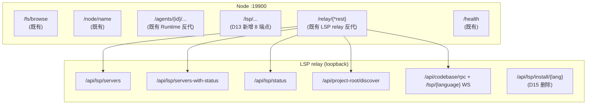

# ADR-091: LSP Server 注册表下沉到 Node — preset ∪ custom 合并、install state 持久化

**状态**：已实施（P0–P7 全部落地；落地后的文件与行号已回写，见 §9 末尾「落地状态」）
**日期**：2026-10-09（2026-10-10 修订并实施）
**决策者**：评审完成，已实施
**关联**：
- [ADR-019](./ADR-019-lsp-relay-standalone-process.md)（LSP relay 解耦为独立进程）
- [ADR-030](./ADR-030-sidecar-endpoint-dynamic-push.md)（Sidecar 端点动态推送）
- [ADR-055](./ADR-055-remote-runtime-node-topology.md)（§6.7 Sidecar Scope 模型）
- [ADR-087](./ADR-087-node-agent-owner-permissions.md)（Node 归属门控；custom/install 走 manage 权限）
- [ADR-089](./ADR-089-lsp-relay-reachability-vs-exposure.md)（D2 Gateway → Node → LSP relay 反代）
- [ADR-090](./ADR-090-mcp-lsp-install-ownership-node.md)（同期拆分；本 ADR 是其 LSP 部分的独立演进）

---

## 1. 决策摘要

### 1.1 一句话

LSP server 的 install 与 spawn 同在 Node 本机（`rustup component add rust-analyzer` / `pip install python-lsp-server` 等产物在 Node 文件系统），因此 **server 注册表的权威源在 Node**，不在 Gateway。Gateway 退化为纯反代。

`assets/lsp_servers.json` 改为**只读 preset**（随套件分发，运行时 MUST NOT 写）；新增 `{node_home}/lsp_servers.json` 作为**唯一运行时真相**（preset ∪ custom ∪ install state），Node 启动时合并、运行时读写。

### 1.2 与 ADR-090（MCP）的边界

| 维度 | ADR-090 MCP | ADR-091 LSP（本 ADR） |
|------|------------|---------------------|
| 现有 registry 位置 | Gateway 持 `mcp_catalog.json` | Node 已有 `acowork/nodes/{id}/lsps` topic 上行，Gateway 仅消费 |
| 待迁出的真相源 | Gateway 侧 catalog + list + key_vault | 无遗留；现状仅读 preset |
| `acowork/global/<thing>` topic 推 push | 活路径（含 pm/doc 托管 MCP） | 已废弃（[node_registry.rs:35-46](../../../core/acowork-gateway/src/mqtt/node_registry.rs#L35)） |
| install 耗时 | MCP `pipx install` 分钟级 | LSP `pip install` 秒级（idle timeout 60 s） |
| install 执行者 | Agent（Runtime 进程，首次启用时） | **Node 进程**（relay 是 sidecar，不是 spawn-on-demand） |
| 跨进程真相 | 无跨进程同步——注册表留 Gateway，install 下沉 Agent，PATH 即状态（[ADR-090 §决策 C](./ADR-090-mcp-lsp-install-ownership-node.md)） | **Node ↔ LSP relay 两进程**（Node 持文件权威，relay 只读该文件并负责 probe） |
| Runtime 是否知情 | Runtime 直读 mcp_servers.json | Runtime 不参与 LSP，**LSP 与 Runtime 物理隔离** |
| 迁移成本 | 一次性拆 catalog → 多 Node | **无迁移**——custom server 从未支持过 |

> 结论：LSP 比 MCP 简单一档——没有 Gateway↔Node 的真相同步、没有 Gateway 托管 LSP、没有 Runtime 参与、没有遗留数据可迁。**本 ADR 的全部风险在 Node 进程内部，以及 Node ↔ LSP relay 这一对同机进程之间的状态收敛**（谁 probe、谁回写、配置变更如何传播；见 §5.6/§5.8）。

### 1.3 关键决策表

| # | 决策 | 内容 |
|---|------|------|
| D1 | preset 只读、随套件安装 | `assets/lsp_servers.json` + `assets/lsp_install/`（现状不变），运行时 MUST NOT 写 |
| D2 | runtime 文件为唯一真相 | `{node_home}/lsp_servers.json` = preset ∪ custom ∪ install state 三合一 |
| D3 | 路径域区分、不引入后缀 | runtime 文件与 preset 同名 `lsp_servers.json`，靠目录区分（`assets/` vs `{node_home}/`） |
| D4 | Node 平铺 | 遵循 `{node_home}` 现有约定（`identity.json` / `state.json` / `packages/` / `logs/` / `runtime-logs/` 全平铺），新增 `lsp_servers.json` 同层放置 |
| D5 | `source` 字段持久化 | 每条目携带 `source: "preset" \| "custom"`，用于 UI 分组与合并判定 |
| D6 | 合并规则：元数据刷新、实例与状态保留 | preset 升级刷新 `candidates/args/description/install_hint/install_script/root_markers`；保留用户 `candidate_args` 与 `install_state` |
| D7 | 不做 reset-to-preset | 不提供「恢复 preset 默认值」入口；用户改错自行改回 |
| D8 | 文件权限 0600 + 原子写 | runtime 文件 MUST `tmp + fsync + rename`；POSIX 0600，Windows 走 ACL 或降级 no-op + warn |
| D9 | install state 持久化，**由 Node 收敛** | install 完成后写 `install_state` 段；relay probe 结果由 **Node 拉取 loopback `/api/lsp/status` 后回写**（relay MUST NOT 写 runtime 文件，见 P6 红线） |
| D10 | `installing` 不持久化 | 进程崩溃后无残留 `installing`；in-flight 仅存内存，丢失即下次重试 |
| D11 | Node 单一写者 | Node 内存态为唯一读写入口（`Arc<RwLock<LspRegistry>>`），所有 handler 在写锁内 mutate + 单点 `save()`；install 串行由 `LspInstallGuard` 保护 |
| D12 | LSP relay 重启模型 | 配置变更触发 relay 进程重启（supervisor 接管，**带去抖**）；relay 自身无热重载（`OnceLock` 单次加载）。代价：重启掉断编辑器在用的 LSP WebSocket（§7.2-2） |
| D13 | Node 端 API 契约 | Node HTTP server 在 `/lsp/...`（无 `/api` 前缀，与 `/fs/browse` / `/node/name` 既有约定一致）暴露 **8** 端点；Gateway 经 `/api/nodes/{id}/lsp-admin/{*tail}` 反代（不复用现有 `/api/nodes/{id}/lsp/{*tail}` 透传路径） |
| D14 | ADR-087 门控在 **Gateway** | custom 创建 / `PUT` / `DELETE` / `install` 由 Gateway 的 `lsp_admin_proxy` handler 内联 `ownership::can_manage` 判定后转发；Node 侧只校验 node token（§5.7） |
| D15 | relay 的 install 端点退役 | `POST/GET /api/lsp/install/{language}` 从 LSP relay 删除——安装唯一执行者是 Node，否则走 relay 装的永远不写 `install_state`（§5.10） |
| D16 | preset 资产目录与 runtime 目录分离 | `ACOWORK_LSP_CONFIG_DIR`（runtime 文件所在，= `{node_home}`）与 `ACOWORK_LSP_ASSET_DIR`（`lsp_servers.json` preset + `lsp_install/` 脚本，= Desktop resource dir）拆成两个 env，避免把 config dir 改指 `{node_home}` 后安装脚本解析退化（§5.11） |

---

## 2. 背景与现状事实

### 2.1 LSP 物理链路（参照系）

| 阶段 | 位置 |
|------|------|
| preset 元数据 | `assets/lsp_servers.json`（version 1，12 个内置：`rust` / `python` / `typescript` / `go` / `c` / `json` / `yaml` / `html` / `css` / `markdown` / `java` / `kotlin`） |
| install 脚本 | `assets/lsp_install/{rust,python,typescript,go,clangd,json,yaml,markdown,kotlin,java,css,html}.{sh,ps1}`（12 套） |
| dev 拷贝 | `apps/acowork-desktop/src-tauri/build.rs:142-156` → `target/{profile}/bin/` |
| release 打包 | `apps/acowork-desktop/src-tauri/tauri.conf.json:58` `bundle.resources` 映射 |
| 定位注入 | `apps/acowork-desktop/src-tauri/src/commands/gateway.rs:545` `env("ACOWORK_LSP_CONFIG_DIR", resource_dir)` |
| 加载候选 | [`core/acowork-lsp-relay/src/config.rs::build_config_candidates()`](../../../core/acowork-lsp-relay/src/config.rs)：`$ACOWORK_LSP_CONFIG_DIR` → `$CARGO_MANIFEST_DIR/../../assets` → `exe_dir` → `cwd` |
| fallback | `builtin_lsp_defaults()`（[config.rs:239](../../../core/acowork-lsp-relay/src/config.rs#L239)） |
| install 执行 | LSP relay `POST /api/lsp/install/{language}`（原 relay `install.rs:77`，本 ADR 的 P6 已随路由一并删除该文件），Desktop `lspInstallStore` 直接调用——本 ADR 把它搬到 Node（D15，落地见 [lsp_install.rs:103](../../../core/acowork-node/src/lsp_install.rs#L103)） |
| 端点转发 | Gateway `lsp_proxy.rs:49` `/api/nodes/{id}/lsp/{*tail}` → Node `/relay/{*tail}`（[proxy/mod.rs:66](../../../core/acowork-node/src/proxy/mod.rs#L66)）→ LSP relay loopback |

### 2.2 LSP 现状缺的两项能力（本次修正目标）

1. **不能新增 server**——`LspServerEntry` schema 已完整（[config.rs:24-44](../../../core/acowork-lsp-relay/src/config.rs#L24)），但只有 `assets/lsp_servers.json` 的 override 入口，**没有 user-side 新增 key 的能力**。「preset ∪ custom 合并」问题从未暴露。
2. **install state 不持久化**——只有进程内的探测缓存 `STATUS_CACHE: OnceLock<RwLock<HashMap<String, (LspServerStatusEntry, Instant)>>>`（[config.rs:1104](../../../core/acowork-lsp-relay/src/config.rs#L1104)，TTL 默认 1800 s），每次重启重新探测 12 个 LSP binary。custom server 引入后这个缺陷会被放大（安装脚本可能分钟级）。

### 2.3 LSP install 与 spawn 的真实语义

- **install** = 安装 language server 二进制（`rustup component add` / `pip install python-lsp-server` / `npm install -g typescript-language-server` 等）；产物在 Node 文件系统
- **spawn** = LSP relay 按需 `tokio::process::Command::new(candidate)` 拉起（[config.rs:1226](../../../core/acowork-lsp-relay/src/config.rs#L1226) `probe_one`）；在 relay 进程内执行（relay 是 Node 的子进程，所以下游仍在同一台机器）
- **探测代价不是毫秒级**：`probe_one` 是 `cmd --version` 的 fork+exec，单次 ~2 s 超时、并发受 `LSP_STATUS_PROBE_CONCURRENCY` 限制，relay 自己的注释写「13 语言约 6 s」（[config.rs:1057-1061](../../../core/acowork-lsp-relay/src/config.rs#L1057)、[config.rs:1126-1132](../../../core/acowork-lsp-relay/src/config.rs#L1126)）——TTL 缓存就是为它而存在。本 ADR 的启动校验 MUST 异步化（§5.8）
- **现状没有 `install_state` 枚举**：relay 只有 `LspServerStatusEntry{language, installed: bool, command}`；`unknown/detected/installing/installed/failed` 与 `InstallStage` 都是本 ADR **新造**的类型（§5.2），不是「沿用」
- 与 MCP 的 `kind=="script"` 不同：LSP install 全部走**套件内脚本**（`assets/lsp_install/*.sh`），**没有"用户粘贴 shell 字符串"的概念**（详见开放问题 Q1）

### 2.4 `acowork/nodes/{node_id}/lsps` 已就位

`core/acowork-gateway/src/mqtt/node_registry.rs:35-46` 注释：LSP server 列表走 **per-node retained topic**，deprecated 的 `acowork/global/lsps` 已下线。`AvailableLsps` envelope 由 Node 上报（含 `lsp_endpoint` 用于 health probe），Gateway 只消费不生产。**本 ADR 不需要新增 Gateway→Node 推送通道**，是单向的"Node → Gateway"事实广播。

### 2.5 `LspTab` UI 已按 Node 过滤

[`apps/acowork-desktop/src/components/harness/LspTab.tsx`](../../../apps/acowork-desktop/src/components/harness/LspTab.tsx#L106) 已有 Node picker（`relayNodes` 状态、`effectiveNodeId` 解析、`fetchNodes()` 拉候选）；通过 ADR-089 D2 反代读 `{relay}/api/lsp/servers`（LspTab.tsx:202）+ `{relay}/api/lsp/status`（LspTab.tsx:238）——`servers-with-status` 存在 `gateway-api.ts:641` 但 UI **不用**它（该文件注释明写它不是首选加载路径）。安装走 `{relay}/api/lsp/install/{lang}`（`lspInstallStore`）——本 ADR 把安装、新增、状态读取改到 Node API。

**本 ADR 仅扩展 LspTab 的能力面（custom server、install state 列），不重构 Node 选择器。**

### 2.6 `{node_home}` 现状

[cli.rs:60-63](../../../core/acowork-node/src/cli.rs#L60)：`--home`（visible alias `--work-dir`，env `ACOWORK_NODE_HOME`），默认 `$HOME/.acowork/acowork-node`；代码里的字段名是 `NodeConfig::home`。实测内容：

```
identity.json  state.json  packages/  logs/  runtime-logs/
```

无 `data/` 子目录。**D4 据此选择平铺。**

---

## 3. 备选方案

| 方案 | 描述 | 否决理由 |
|------|------|---------|
| A. Gateway 持 LSP registry + 派发 install | 仿 MCP 旧方案 | LSP install 产物在 Node；Gateway 持 registry 必导致双源；且 Node 端已有 `acowork/nodes/{node_id}/lsps` 上行通路，再加一条 Gateway→Node 推送是 A 类反模式 |
| B. `custom` 走 per-agent 目录 | 放在 `{work_dir}/lsp_servers.json` | LSP 是 Node 全局资源（与语言绑定，与 agent 无关），per-agent 目录会跨 agent 重复 install；且 `{work_dir}` 在多 user 场景下被 ADR-087 隔离，不是 Node 全局视图 |
| **C. 本 ADR** | preset 只读 + Node runtime 文件唯一真相 + Gateway 纯反代 | — |

---

## 4. 决策理由

1. **install 与 spawn 同机是硬约束**。LSP relay 是 Node 拉起的 loopback 子进程，它再 `Command::new` 拉起 language server——二进制必须落在同一台机器的同一个文件系统。
2. **单源优于双源**。`acowork/nodes/{node_id}/lsps` 已是 Node 权威上行；runtime 文件与它一致后，Gateway 仅在 `lsp_endpoint` health probe 上消费。
3. **LSP 链路已被验证**。`build.rs` 拷贝、tauri 资源映射、`ACOWORK_LSP_CONFIG_DIR` env 注入、supervisor 拉起、Gateway 反代——五段全有现成实现，本次复用而非发明。
4. **install state 持久化的价值**。当前每次重启都全量 `probe_all`（12 个 binary 的 `--version` fork+exec，**秒级**，靠 TTL 缓存掩盖），价值小；但 **custom server 的 install 路径**（用户自己引用的 install script）会显著变慢且无幂等保护，持久化的价值大。
5. **LSP 与 MCP 拆开**。用户要求二者独立演进——MCP 涉及 Runtime / Gateway / Node 三方协同、LSP 仅在 Node 内部，**强行合写会让两份 ADR 的读者互相干扰**。

---

## 5. 详细设计

### 5.1 文件布局

```
安装目录（只读，随套件分发）
  assets/lsp_servers.json          # 现状不变（D1）
  assets/lsp_install/*.sh|*.ps1    # 现状不变

{node_home}/                       # $HOME/.acowork/acowork-node
  identity.json                    # 现状
  state.json                       # 现状
  lsp_servers.json                 # 新增，唯一运行时真相（D2/D3）
  packages/  logs/  runtime-logs/  # 现状
```

两个目录职责分离（D16）：

| env | 含义 | 取值 | 注入方 |
|-----|------|------|--------|
| `ACOWORK_LSP_CONFIG_DIR` | **runtime** 文件所在目录（= `{node_home}`） | Node 启动时自己设 | Node supervisor |
| `ACOWORK_LSP_ASSET_DIR` | preset 资产目录（`lsp_servers.json` + `lsp_install/`） | Desktop resource dir | Desktop 现有注入链（gateway.rs:545 的变量重命名后透传） |

> 原 ADR 拟把 `ACOWORK_LSP_CONFIG_DIR` 直接改指 `{node_home}` ——那会让安装脚本的候选 0（`{config_dir}/lsp_install/`）落空，只剩 `exe_dir` / 祖先 `assets/` 兜底。拆两个 env 后，preset 与脚本仍由同一个已知目录提供（Node 侧候选链：[lsp_install.rs:103](../../../core/acowork-node/src/lsp_install.rs#L103)），runtime 文件单点定位 `{node_home}/lsp_servers.json`（不靠候选链）。

### 5.2 schema

**preset（只读，`assets/lsp_servers.json`）**——现状不变：`version: 1, servers: IndexMap<String, LspServerEntry>`。

**runtime（读写，`{node_home}/lsp_servers.json`）**——每条目三段：

```json
{
  "version": 1,
  "servers": {
    "rust": {
      "source": "preset",

      "candidates": ["rust-analyzer"],
      "args": [],
      "candidate_args": {},
      "install_hint": "rustup component add rust-analyzer",
      "install_script": "rust",
      "description": "Rust language server (defaults to stdio, no --stdio flag)",
      "root_markers": ["Cargo.toml"],

      "install_state": "installed",
      "installed_command": "rust-analyzer",
      "install_stdout": "...(截断 4 KB)",
      "install_stderr": "...(截断 4 KB)",
      "last_install_ms": 1762000000000
    },
    "my-team-lsp": { "source": "custom", "candidates": ["my-lsp"], "...": "..." }
  }
}
```

- `servers` MUST 为 `IndexMap`（LSP 已踩过 `HashMap` SipHash 随机种子坑，注释见 [lsp.rs:180](../../../core/acowork-core/src/lsp.rs#L180)，P0 后类型住在 core）
- **元数据段**（`candidates` / `args` / `candidate_args` / `install_hint` / `install_script` / `description` / `root_markers`）来自 preset，preset 升级时刷新（D6）。Node 侧用 `#[serde(flatten)] meta: LspServerEntry` 包住这段，所以 JSON 形状与 relay 读的 preset 一致
- **实例段**（custom server 的实例段全段由用户填；preset server 的实例段用户可覆盖 `candidate_args`）
- **状态段**（`install_state` / `installed_command` / `install_stdout` / `install_stderr` / `last_install_ms`）由 install / 收敛流程写（§5.8）
- relay 反序列化时 **MUST NOT 认识状态段**：`LspServerEntry` 没有 `deny_unknown_fields`，多余键被忽略——这既是兼容前提，也是 P6 红线的技术基础（relay 只看到 metadata 段）

`install_state` 取值（**本 ADR 新定义的枚举**，与 relay 的 `LspServerStatusEntry{installed,command}` 并存）：

| 值 | 含义 | 可持久化 |
|---|------|---------|
| `unknown` | 未探测过 / 上次结果已失效 | 是 |
| `detected` | 探测到 binary 在 PATH（非我们装的） | 是 |
| `installed` | 由本流程的 install script 装成 | 是 |
| `failed` | 最近一次 install 非 0 / 超时 | 是 |
| `installing` | in-flight，仅存内存 | **否**（D10） |

### 5.3 合并规则

```
load_lsp_servers(node_home, preset_registry):
  runtime = read({node_home}/lsp_servers.json) or empty
  merged  = IndexMap::new()
  conflicts = []

  for (name, preset) in preset_registry.servers:           # 按 preset 顺序
    match runtime.get(name):
      Some(e) if e.source == "custom":
        # 重名（preset 升级新增了一个用户已自定的名字）：
        # 保留 custom 条目，不静默覆盖，也不写回 runtime 文件
        merged[name] = e
        conflicts.push(name)                                 # UI 顶栏提示
      Some(e) /* source == preset */:
        merged[name] = LspRuntimeEntry {
          meta: preset.meta,                                 # 元数据段 ← preset 刷新
          candidate_args: e.candidate_args,                  # ← runtime 保留
          state: e.state,                                    # install_state ← runtime 保留
          source: "preset",
        }
      None:
        merged[name] = LspRuntimeEntry {
          source: "preset", meta: preset.meta, state: unknown,
        }

  for (name, entry) in runtime.servers:
    if entry.source == "custom" and name not in merged:
      merged[name] = entry                                  # custom 原样保留（追加在 preset 之后）

  return (merged, conflicts)
```

重名策略：preset 名与 custom 名冲突时**以已存在（custom）条目为准**，冲突列表随响应上报给 UI，用户自行重命名或删除；「新增 custom」入口同时校验名称在整个 registry（含 preset）唯一。

顺序不变量：merged 永远先 preset（按 preset 文件顺序）后 custom（按 runtime 文件顺序），两者都是 `IndexMap`，所以 UI 列表跨重启稳定。

### 5.4 写入与权限（D8 + D11）

```
save_lsp_servers(node_home, servers):
  final = {node_home}/lsp_servers.json
  tmp   = final.with_extension("json.tmp")
  write(tmp, serde_json::to_string_pretty(servers))
  f.sync_all()
  set_permissions(tmp, 0o600)          # POSIX；Windows 走 ACL 或降级 no-op + warn
  rename(tmp, final)                   # POSIX 原子
```

`install_stdout` / `install_stderr` 含安装过程的 npm/pip 输出，**可能夹带 token**（npm 私有 registry / pip index URL 嵌入 auth），0600 同样适用。

**Node 单一写者（D11）**：`Arc<RwLock<LspRegistry>>` 是 Node 内存态唯一真相；所有 Node HTTP handler 必须在写锁内 mutate map + 调用一次 `save()`（与 `identity`/`node` 表同一套 `tokio::sync::RwLock` 惯例）。`LspInstallGuard` 降级为"同 name 不并发 install"的 UX 保护，**不再是并发正确性依赖**——`PUT /lsp/servers/{name}`（改 `candidate_args`）与 `POST .../install`（写状态段）并发会 lost update。

注意：写锁 MUST NOT 跳 `.await` 持有（install 子进程、relay HTTP 收敛都在锁外进行，结果再进锁写回）—— Node 的 `/health` 就是靠探这个锁来识别锁跨越 await 的卡死类问题（[proxy/mod.rs:70-102](../../../core/acowork-node/src/proxy/mod.rs#L70)）。

### 5.5 Node 端 API 与 Gateway 反代（D13）

**Node 侧（`:19900`，node token 鉴权，无 `/api` 前缀）**：

```
GET    /lsp/servers                       # merged registry（preset ∪ custom + 持久化 install_state）
GET    /lsp/presets                       # 只读 preset registry（UI 新增表单的候选源）
GET    /lsp/servers/{name}/script         # 安装脚本文本（D14 「执行前展示脚本」依赖它）
POST   /lsp/servers                       # 新增 custom（name 冲突 409）
PUT    /lsp/servers/{name}                # 改实例段（candidate_args / install_script / ...）
DELETE /lsp/servers/{name}                # 卸载记录（不删语言服务器产物）
POST   /lsp/servers/{name}/install        # 执行 install_script，写回 state（D15：唯一安装入口）
GET    /lsp/servers/{name}/install/status # in-flight 阶段（内存态，新枚举）
```

共 **8** 端点。删掉原稿的 `GET /lsp/servers-with-status`：relay 侧那个 combined 形状 UI 本来就不用（§2.5），Node 再实现一份等于把 probe 逻辑复制一遍；实时探测继续走 relay 的 `/api/lsp/status`（透传路径），持久化状态走 `GET /lsp/servers`。

**LSP relay 端点**：`/api/lsp/servers`、`/api/lsp/status`、`/api/lsp/servers-with-status` 保留，由 LSP relay 暴露在 loopback，Node 经 `/relay/{tail}` 反代透传；`/api/lsp/install/{language}` 删除（D15）。本 ADR 的 8 个 Node API 与 relay 读端点共存于 Node 路由树：



**Gateway 侧**：现有 `/api/nodes/{id}/lsp/{*tail}` → Node `/relay/{*tail}`（ADR-089 D2 路径，**LSP relay 端点透传，不变**）。**新增** 反代路由 `/api/nodes/{id}/lsp-admin/{*tail}` → `http://{node.http_endpoint}/lsp/{tail}`，注入 `X-ACowork-Node-Token`，结构照抄 `lsp_proxy.rs`。两个与现有实现的差异：

1. **门控层级不同**：admin 路径在转发前查 `can_manage`（§5.7），而透传路径只查 `can_view`；
2. **MUST NOT 复用 `resolve_relay_target` 的 `lsp_endpoint.is_some()` 前置**（[lsp_proxy.rs:221](../../../core/acowork-gateway/src/http/lsp_proxy.rs#L221)）：relay 未就绪时恰恰是用户要修配置 / 装 server 的时刻。admin 只要求 node `online` + 有 `http_endpoint`。

> **路径前缀与既有约定的对齐**：Node 现有路由**无 `/api` 前缀**（`/fs/browse` / `/node/name` / `/agents/{id}/...`），故 Node 侧 API 用 `/lsp/...`。Gateway 侧用 `/api/nodes/{id}/lsp-admin/...`（与 ADR-089 D2 的 `/api/nodes/{id}/lsp/...` 同形但前缀不同），UI 与 `lspStore` 据此区分读 vs 写。

### 5.6 Node 端状态变更对 LSP relay 的传播（D12）

```
Node 启动:
  1. 读 preset（ACOWORK_LSP_ASSET_DIR）+ 读 runtime（{node_home}/lsp_servers.json）
  2. merge → 内存态；save() 落盘（首次启动即生成 runtime 文件）
  3. spawn LSP relay（supervisor 接管）：
       ACOWORK_LSP_CONFIG_DIR={node_home}      # runtime 文件
       ACOWORK_LSP_ASSET_DIR=<resource dir>    # preset + lsp_install 脚本
     （env 由 `relay_env()` 在 Command 上显式 `.env` 注入，不依赖父进程继承——
      [lsp_relay.rs:125-145](../../../core/acowork-node/src/sidecar/lsp_relay.rs#L125)）

配置变更（custom 增删 / 实例段修改 / preset 升级）:
  1. handler 在写锁内 mutate + save()（锁外）
  2. 向 supervisor 发 RestartRequest（mpsc），supervisor kill + respawn relay
  3. relay 重新 init + 读 runtime 文件
  4. 状态收敛：§5.8（Node 拉 loopback `/api/lsp/status`，回写 install_state）
```

LSP relay 自身无热重载（`OnceLock` 单次加载，参见 [config.rs:113](../../../core/acowork-lsp-relay/src/config.rs#L113)），所以配置变更的传播成本是**一次 relay 重启**。不引入新的 reload 协议（YAGNI），但两条必须：

1. **去抖**：一次表单提交可能连带多个写操作（新增 + 设参 + 安装）；RestartRequest 走合并窗口（1 s 内的请求归并为一次重启），避免 N 次重启风暴。已落地：`RESTART_DEBOUNCE` = 1 s，`RESTART_DEBOUNCE_MAX` = 3 s 封顶——持续写入的 UI 不能无限推迟重启（[lsp_relay_supervisor.rs:45-51](../../../core/acowork-node/src/sidecar/lsp_relay_supervisor.rs#L45)）。
2. **代价真实存在**：重启会掐断编辑器在用的 LSP WebSocket 连接（`/lsp/{language}` WS，[server.rs:330](../../../core/acowork-lsp-relay/src/server.rs#L330)）和 `HeartbeatWatchdog` 正在跳的心。因此：配置写 API 的响应体 MUST 带上「将重启 relay」的标志（`will_restart`），且 **UI 的二次确认 MUST 前置在写请求之前**——去抖窗口一到重启就发生，提交以后 UI 已无权否决，`will_restart` 只承担展示与告警；空闲（无编辑器会话）时才做隐式重启（Q5，本次未做）。（归属 §7.2-6 风险）

重启通道已建立：写 handler 通过 mpsc 发 `LspRelayRestartRequest`（[lsp_api.rs:449](../../../core/acowork-node/src/lsp_api.rs#L449)），supervisor 收 `MonitorExit::ConfigRestart` 后 kill + respawn；故障重启路径不变（[lsp_relay_supervisor.rs:217](../../../core/acowork-node/src/sidecar/lsp_relay_supervisor.rs#L217)）。没有 supervisor 在听时 `will_restart` 如实返回 false，不向 UI 承诺拿不到的重启。

### 5.7 鉴权（D14）

**权限判定在 Gateway，不在 Node。** 这不是风格选择，是现有架构的硬约束：

- Node 的 [proxy/mod.rs:222](../../../core/acowork-node/src/proxy/mod.rs#L222) `authorize` 只做 `X-ACowork-Node-Token` 常量时间比较——Node **没有调用者身份**（无 user/session 概念），也没有 `node_registry` 视图：`NodeHttpState` 加了 P2 的两个 LSP 句柄之后仍只有 `node / identity / config / lsp / lsp_relay`，没有一个「谁在调」的主体可供判定（[state.rs:324](../../../core/acowork-node/src/state.rs#L324)）。
- 既有约定就是「Gateway 查权限 → 带 node token 转发」：[node_api.rs:8-11](../../../core/acowork-node/src/node_api.rs#L8) 注释与 `lsp_proxy.rs:211-216` 的内联 `can_view` 校验都是这个模式。
- 中间件不会自动 gate：`permission.rs::extract_target` 对 `/api/nodes/{id}/lsp-admin/*` 落到 `Target::None`（[permission.rs:95-125](../../../core/acowork-gateway/src/http/permission.rs#L95)，`lsp` / `lsp-admin` 两段都走 [is_lsp_proxy_rest](../../../core/acowork-gateway/src/http/permission.rs#L49)），所以 **必须** 在 `lsp_admin_proxy` handler 内显式校验（[lsp_admin_proxy.rs:89-92](../../../core/acowork-gateway/src/http/lsp_admin_proxy.rs#L89)：读 `can_view`，`Tier::Manage` 再加 `can_manage`）。

| 层 | 路由 | 鉴权 |
|----|------|------|
| Gateway | `GET /api/nodes/{id}/lsp-admin/servers`、`/presets`、`/{name}/script`、`/{name}/install/status` | 会话有效 + `can_view`（读不需要 manage） |
| Gateway | `POST/PUT/DELETE .../lsp-admin/servers[/{name}]`、`POST .../install` | 会话有效 + **`can_manage`** |
| Gateway | `GET /api/nodes/{id}/lsp/{*tail}`（现有透传） | `can_view`（不变） |
| Node | `/lsp/...` | node token（与现有 Node 路由一致，不再加一层） |

> 安全前提：Node `:19900` 只监听 loopback / LAN，且只接受带正确 node token 的请求；能拿到 token 的只有 Gateway（ADR-089 D2）——所以「谁能装任意 shell」这个判定 MUST 落在持有身份的 Gateway，而不是只会比 token 的 Node。

install 的「执行前展示脚本内容 + 用户确认」是 UI 侧门（拿 `GET .../script` 渲染后确认），不是权限门；真正的门是 `can_manage`。

### 5.8 启动与运行期的 install state 收敛（D9）

**仍由 relay probe，由 Node 回写。** 原稿写的「LSP relay 启动时校验并把结果写回 runtime 文件」与本 ADR 的「Node 单一写者」（D11）直接矛盾：relay 侧 `STATUS_CACHE` 是 `OnceLock` 进程内状态，它既不认识 `install_state` 字段，也不持有 `{node_home}` 写权限。修正后：

```
收敛触发点（全部在 Node 侧）:
  a) relay ready（SSE /events 首次心跳）后异步一次
  b) install 完成后立即一次
  c) `GET /lsp/servers` 发现上次收敛超过 TTL 时后台一次

单次收敛流程:
  1. GET http://{relay}/api/lsp/status?force=true     # 用 sidecar 已知的 loopback 地址
  2. 逐条映射到 install_state：
     installed=true 且原状态 == installed → installed（保留）
     installed=true 且原状态 == unknown/detected → detected
     installed=false → unknown（降级，不报错；binary 可能临时不可用）
  3. 进写锁 mutate + save()（一次）
```

落地：三个触发点、上述映射与 single-flight 归并在 [lsp_converge.rs](../../../core/acowork-node/src/lsp_converge.rs)（`spawn_converge` / `converge_now`），回写落在 [lsp_registry.rs:337](../../../core/acowork-node/src/lsp_registry.rs#L337)。c) 走 `force=false`（复用 relay 自己的 TTL 缓存，避免 UI 每次挂载都 13 次 fork），a)、b) 走 `force=true`。

**probe 代价（修正原稿的 60 ms 说法）**：probe 是 `cmd --version` fork+exec，单次 ~2 s 超时，13 语言全量 **约 6 s**（relay 注释原话，[config.rs:1096-1100](../../../core/acowork-lsp-relay/src/config.rs#L1096)）。所以：

- 收敛 MUST 异步（不阻 Node 启动，不阻 `GET /lsp/servers` 返回）；
- 沿用 relay 的 TTL 缓存（默认 1800 s）作为节流；
- 前端拿到的安装列在收敛完成前是持久化值（可能 `unknown`），不是实时值——UI 用「上次检查时间 + spinner」表达（§5.5 P5）。

relay MUST NOT 写 runtime 文件。红线已落地：`dev/ci.sh` 的 `run_lsp_registry_redline`（[dev/ci.sh:416](../../../dev/ci.sh#L416)）分三段扫 relay crate —— install-state 词汇、`/api/lsp/install` 路由字面量、文件写入调用点上限，已接进 `check` 与 `all`。

### 5.9 LSP server entry 类型共享（P0）

`LspServerEntry` 迁移前定义在 relay 的 config.rs。Node 反向引用它会引入 `acowork-node → acowork-lsp-relay` 依赖，所以 **抽到 `core/acowork-core/src/lsp.rs`**（P0 已落地：[lsp.rs:146](../../../core/acowork-core/src/lsp.rs#L146)），Node 与 lsp-relay 共用同一份 schema。

依赖事实修正（原稿说「不引入新 crate 依赖」，不成立）：

- `LspServerEntry` 用 `IndexMap`，而 [acowork-core/Cargo.toml](../../../core/acowork-core/Cargo.toml) 与 [acowork-node/Cargo.toml](../../../core/acowork-node/Cargo.toml) **都没引 indexmap**（workspace 根 Cargo.toml:51 已声明版本，所以是加一行 `[dependencies] indexmap = { workspace = true }`，不是选新库）
- 同样需要的新依赖：Node 侧写文件用已有的 `tokio::fs` / `tempfile`（确认后再加）
- MUST NOT 引入 `acowork-node → acowork-gateway`（ADR-055 §6.20 约束）

类型清单（全部落在 `acowork-core::lsp`）：`LspServerEntry`（迁入，**不加新字段**）、`LspServersConfig`（preset 文件形状，也在 relay 里，一并迁入）、`LspSource`（新）、`LspInstallState`（新）、`LspInstallRecord`（新：状态 + 证据）、`LspRuntimeEntry { #[serde(flatten)] metadata, #[serde(flatten)] install, source }`（新）、`LspRegistryFile { version, servers: IndexMap<…> }`（新）。

`source` 故意只住在 `LspRuntimeEntry` 上，不进 `LspServerEntry`：preset 文件的 schema 一个键都不能多（它是只读发行物），而 runtime 文件多出来的 `source` / 状态段对 relay 透明（多余键被serde 忽略）。

### 5.10 relay 的 install 端点退役（D15）

**（P6 已落地）**迁移前的现状：UI 的安装走 `POST {relay}/api/lsp/install/{language}`，安装成功后 relay 调 `refresh_path_from_profiles()` + `invalidate_status()`。若保留它，走这条路装的永远不写 `install_state`（runtime 文件在 Node 手里），D9/D11 失效。因此本次：

| 动作 | 落地位置 |
|------|---------|
| 删路由 `GET/POST /api/lsp/install/{language}`，整个 `install.rs` 随之下架 | relay 只剩只读 probe 面（[server.rs:328-336](../../../core/acowork-lsp-relay/src/server.rs#L328)）；[integration.rs](../../../core/acowork-lsp-relay/tests/integration.rs) 保留一条 GET/POST 404 断言，防止第二条写路径长回来 |
| 安装逻辑上提为 Node 自有模块 | [lsp_install.rs](../../../core/acowork-node/src/lsp_install.rs)（脚本解析 / 子进程执行 / 超时不删；不通过依赖 relay crate 复用） |
| PATH 刷新保留在 relay | `refresh_path_from_profiles()` 影响的是 relay 自己的 probe/spawn 环境，Node 装完无法隔进程改到——所以 **install 不重启 relay**，改为 forced probe 前先刷 PATH（[config.rs:811](../../../core/acowork-lsp-relay/src/config.rs#L811)），不新增 IPC |
| UI 改路径 | P5：`lspInstallStore` 请求 `/api/nodes/{id}/lsp-admin/servers/{name}/install`（[gateway-api.ts](../../../apps/acowork-desktop/src/lib/gateway-api.ts)） |

install 响应里 `will_restart` 固定为 `false`（[lsp_api.rs:395-411](../../../core/acowork-node/src/lsp_api.rs#L395)）：字段不删是为了不拆坏写类端的统一契约，也为后续把重启改成显式确认式时兼容。

（preset 安装脚本的 `install_script` 字段名与脚本内容解析规则不变，Node 直接复用同一套候选链。）

### 5.11 preset 资产目录与 runtime 目录（D16）

现状 Desktop 把 `ACOWORK_LSP_CONFIG_DIR` 注入为 resource dir（[gateway.rs:532-547](../../../apps/acowork-desktop/src-tauri/src/commands/gateway.rs#L532)），而 `tauri.conf.json:58` 把 `lsp_install/` 与 `lsp_servers.json` 一起映射进去，[build.rs:142-162](../../../apps/acowork-desktop/src-tauri/build.rs#L142) 在 dev 下把两者拷到 bin 目录。因此：

- **新 `ACOWORK_LSP_ASSET_DIR`**：preset + 安装脚本目录，值就是现在的 resource dir；Desktop 注入给 Gateway，Gateway 透传给 Node（sidecar 启动参数）
- **`ACOWORK_LSP_CONFIG_DIR`** 语义不变但值换：仍指「relay 读 `lsp_servers.json` 的目录」，只是值从 resource dir 改为 `{node_home}`（runtime 文件），由 Node 显式注入 relay
- relay 侧两处候选链调整：
  - `build_config_candidates()`（[config.rs:157](../../../core/acowork-lsp-relay/src/config.rs#L157)）：第 0 档仍是 config dir（= runtime 文件），**在其后新增一档 `ACOWORK_LSP_ASSET_DIR/lsp_servers.json`**——runtime 文件尚未生成（开发场景直接跑 relay）时退回 preset，后续 `exe_dir` / `cwd` 兜底不变
  - 安装脚本候选 0 从 `{config_dir}/lsp_install/` 改为 `{ACOWORK_LSP_ASSET_DIR}/lsp_install/`（脚本不随 runtime 文件走）；该逻辑整体上搬到 Node（D15），relay 侧整个 `install.rs` 随路由删除

这样才不会出现「把 config dir 改指 `{node_home}` 后，安装脚本只能靠 `exe_dir` 兜底碰运气」的回归。

---

## 6. 对既有 ADR 的修正

| ADR | 位置 | 修正 |
|-----|------|------|
| ADR-019 | LSP relay 启动配置 | `ACOWORK_LSP_CONFIG_DIR` 语义收紧为 runtime 目录（= `{node_home}`，由 Node supervisor 显式注入）；新增 `ACOWORK_LSP_ASSET_DIR` 指 preset + 安装脚本（D16 / §5.11） |
| ADR-030 | Sidecar 端点推送 | 无改动（`acowork/nodes/{node_id}/lsps` 链路已就位） |
| ADR-089 | D2 反代路径 | 新增 `/api/nodes/{id}/lsp-admin/{*tail}` 反代路由（与现有 `/lsp/{*tail}` 共存；前者 Node 端 `/lsp/...` API，后者 relay 透传）；admin 路径不复用 `lsp_endpoint` 就绪前置（§5.5） |
| ADR-090 | — | **无冲突**。ADR-090 经评审后已削成 MCP-only（其 §1 D14 与 §4.4 明确排除本 ADR 模型），不存在被本 ADR 取代的 §5.8（原稿引用的是拆分前的旧编号） |
| ADR-055 | §6.7 Sidecar Scope | 追加「LSP server registry 与 install state 权威（`lsp_servers.json`）」 |

ADR-055 需加一行修订记录指向本 ADR。

---

## 7. 后果

### 7.1 正面

1. **LSP install state 跨重启保留**——解决 custom server install 状态丢失导致的 UI 误判
2. **新增 custom server 能力**——填补现状空白（schema 已完整，仅缺入口与状态持久化）
3. **单一真相源**——`{node_home}/lsp_servers.json` 是 Node 端唯一权威；`acowork/nodes/{node_id}/lsps` 上行通路保持不变
4. **LSP 与 MCP 解耦**——按用户要求两者独立演进；本 ADR 不引入任何 MCP 概念
5. **Node 路径前缀一致**——`/lsp/...` 与 `/fs/browse` / `/node/name` 既有约定对齐

### 7.2 负面与代价

1. **API 拆分 UI 读写**——LspTab 实时探测读 `/api/nodes/{id}/lsp/status`（relay 透传，现成），列表与持久化状态、写操作读 `/api/nodes/{id}/lsp-admin/...`（新增），前端 store 需双路区分
2. **LSP relay 重启成本**——配置变更触发一次 relay 重启，而重启会掉断编辑器在用的 LSP WebSocket（全量 probe 本身也是 ~6 s 量级，§5.8）；靠去抖 + 写操作响应带 `will_restart` 标志 + UI 二次确认控制（§5.6）
3. **Windows 0600 降级**——含 install stdout/stderr 的文件无法强制权限，需在 `dev/ci.sh` 增加提示
4. **`LspServerEntry` 提取到 `acowork-core`**——小幅重构 + core/node 各加一行 indexmap 依赖（§5.9）
5. **删 relay install 端点是 breaking**——必须与 P5（UI 改走 lsp-admin）同批落地，不留中间态

### 7.3 风险

| 风险 | 缓解 |
|------|------|
| 多次 install 并发写 runtime 文件 | D11 内存态 RwLock 单一写者；`LspInstallGuard` 仅 UX 保护 |
| Node 重启时 `installing` 残留 | D10 禁止持久化 `installing`；重启后即视为 "unknown" |
| LSP relay 重启期间 in-flight 客户端请求失败 | supervisor 守护 + `relay_not_ready` 503 语义（已有，ADR-089 D4）；写操作先归并去抖再重启（§5.6-1） |
| **relay 重启掉断编辑器在用的 LSP WS** | 写 API 返回 `will_restart`，UI 二次确认；连续写操作归并为一次重启（§5.6） |
| Remote Node 首次启动 runtime 文件不存在 | 走合并空 + 异步收敛，UI 显示 "no LSP installed"；用户可显式刷新或新增 custom |
| 用户手改的元数据被 preset 升级静默覆盖 | D7 不做 reset-to-preset；UI 展示文件路径 + 冲突名上报（§5.3） |
| install script 任意代码执行 | D14 `can_manage`（Gateway 侧）+ UI 展示脚本全文（`GET .../script`）+ 用户确认 + 沿用 `run_command_with_idle_timeout` 60s 超时 |
| Node 与 relay 两进程状态不一致 | 单一写者：relay 不写文件，Node 拉 loopback status 回写（§5.8）+ P6 红线卡住 relay |

---

## 8. 迁移与回滚

**迁移（无）**——`{node_home}/lsp_servers.json` 是新增文件。Node 首次启动时**自动从 preset 合并生成**（[§5.3](#53-合并规则)），旧用户不存在 LSP 自定义（现状不支持 custom server），无数据可迁。

**回滚**：
- 删除 `{node_home}/lsp_servers.json` → Node 下次启动退化为读 `assets/lsp_servers.json`（preset only）
- 撤销 Node 端 `/lsp/...` API 与 Gateway `/api/nodes/{id}/lsp-admin/...` 反代 → LspTab 退化为只读 preset
- LSP relay 切回 `ACOWORK_LSP_CONFIG_DIR` 指向 Desktop `resource_dir`（ADR-019 原始约定）
- 窗口内无用户数据损失（preset 永远在）

---

## 9. 实施边界

按依赖顺序，每步可独立 review：

| # | 内容 | 触及 |
|---|------|------|
| P0 | 将 `LspServerEntry` / `LspServersConfig` 从 relay 迁入 `core/acowork-core/src/lsp.rs`，新增 `LspSource` / `LspInstallState` / `LspInstallRecord` / `LspRuntimeEntry` / `LspRegistryFile`（§5.9）；core + node 各加 `indexmap = { workspace = true }`；relay 改为 `use acowork_core::lsp::*` | `core/acowork-core/src/lsp.rs`（新增）、`core/acowork-lsp-relay/src/config.rs`（删类型）、`core/Cargo.toml` 不动 |
| P1 | Node 端 registry：preset 读取 + §5.3 合并（含冲突上报）+ §5.4 原子写/0600 + `Arc<RwLock<LspRegistry>>` 单一写者 | `core/acowork-node/src/lsp_registry.rs`（新增） |
| P2 | Node HTTP `/lsp/...` 8 端点（§5.5；无 servers-with-status）；install 执行器（从 relay `install.rs` 搬逻辑）；`installing` 仅内存；§5.8 收敛（拉 relay status 回写）；写锁不跳 `.await` | `core/acowork-node/src/lsp_api.rs`（新增）+ `lsp_install.rs`（新增）+ `lsp_converge.rs`（新增，§5.8 三触发点与 single-flight），在 [control/mod.rs:1257](../../../core/acowork-node/src/control/mod.rs#L1257) merge 路由 |
| P3 | supervisor：启动前 load+merge+save；spawn relay 时显式注入 `ACOWORK_LSP_CONFIG_DIR={node_home}` 与 `ACOWORK_LSP_ASSET_DIR`；新增 RestartRequest mpsc + 1 s 去抖；relay ready 后触发首次收敛 | `core/acowork-node/src/sidecar/{lsp_relay.rs,lsp_relay_supervisor.rs}` |
| P4 | Gateway `lsp_admin_proxy`：`/api/nodes/{id}/lsp-admin/{*tail}` → Node `/lsp/{tail}`；写类 method 内联 `can_manage`、读类 `can_view`（§5.7）；不 gate `lsp_endpoint`；在 `permission.rs::extract_target` 的 nodes 分支显式保持 `Target::None`（避免中间件二次 gate 与 handler 打架） | `core/acowork-gateway/src/http/lsp_admin_proxy.rs`（新增）+ `http/mod.rs`/路由装配 |
| P5 | Desktop：LspTab 加 custom server 表单（preset 候选源 `/presets`）+ install state 列 + 新增/编辑/删除/安装改走 `lsp-admin`；`lspInstallStore` 换 URL；实时探测保留读 `/lsp/status`；`will_restart` 二次确认 | `apps/acowork-desktop/src/components/harness/LspTab.tsx`、`src/stores/lspInstallStore.ts`、`src/lib/gateway-api.ts`、`src/lib/types.ts` |
| P6 | 删 relay `GET/POST /api/lsp/install/{language}` 路由（D15，与 P5 同批）；`dev/ci.sh` 新增 `run_lsp_registry_redline`：relay crate MUST NOT 出现 `install_state` / runtime 文件路径读写（照 `run_gateway_fs_redline` 的上限式写法） | `core/acowork-lsp-relay/src/{server.rs,lib.rs,main.rs}`、`src/install.rs`（删除）、`tests/integration.rs`（改 404 守卫）、`dev/ci.sh` |
| P7 | 文档：ADR-055 §6.7 追加 registry 权威行；ADR-019 补 D16 双 env（§6） | `docs/adr/zh/` |

P0–P3 不动 Gateway / Desktop，可先落地供 review 合并规则与文件布局；P4–P6 是一个不可拆的对外行为变更群（写入口 + UI + 删旧路由）。

**落地时的两处与表格的偏差**（已回写到正文）：

1. §5.8 的收敛单独落在 `lsp_converge.rs`，不挤在 `lsp_api.rs` 里——三个触发点分属 supervisor、install handler 与读 handler，需要一个各方都能直接引用的独立模块。
2. `will_restart` 的二次确认前置在写请求**之前**（§5.6-2、Q5）：去抖窗口一到重启就自动发生，提交后 UI 已无权否决。若要把 `will_restart` 当成「重启由确认触发」的信号，会需要一个 relay 并不存在的 ack 通道。

---

## 10. 开放问题

| 问题 | 建议方向 | 落点 |
|------|---------|------|
| Q1. custom server 的 install_script 是否允许内联文本粘贴（与 MCP ADR D13 对称）？ | **不允许**——LSP install 全部走套件脚本，custom 也只引用 `lsp_install/{name}.{sh,ps1}` 脚本名（与 preset 一致）；若需内联需用户在 Node 机本地落脚本后引用文件名 | D14/D15（实施时按此定） |
| Q2. `acowork/nodes/{node_id}/lsps` 上行 schema 是否需要扩展 install_state？ | **不需要**——`lsp_endpoint` 仍是 health probe 唯一信号；install_state 只走 Node 的 `GET /lsp/servers`（上行 topic 形状不动） | §5.8 |
| Q3. `LspServerEntry` 是否提取到 `acowork-core`？ | **是**——避免 Node 直接依赖 lsp-relay 序列化类型；新增 `core/acowork-core/src/lsp.rs`（P0），代价是 core/node 各加一行 indexmap | §5.9 / §9 P0 |
| Q4. 远程 Node 首次启动 runtime 文件不存在时，是否主动从 Gateway 拉 preset 缓存？ | **不拉**——Node 从 `ACOWORK_LSP_ASSET_DIR` 读 preset（Desktop 场景）；单独跑 Node 的开发/CI 场景退回 relay 现有候选链（exe_dir / 祖先 `assets/`），不存 preset 时 registry 为空但仍可手工新增 | §5.11 |
| Q5. 配置变更何时真的重启 relay？ | **已落地：确认前置**——写请求提交前由 UI 弹二次确认，写一旦发出则由去抖窗口归并后自动重启（UI 事后无否决权），`will_restart` 仅作展示与告警标志；「空闲（无编辑器会话）时隐式重启」与「写完再确认式重启」留给下一个 ADR | §5.6-2 / §9 偏差 2 |

---

（ADR-091，2026-10-09 起草；2026-10-10 对照代码评审修订，并完成 P0–P7 实施）
